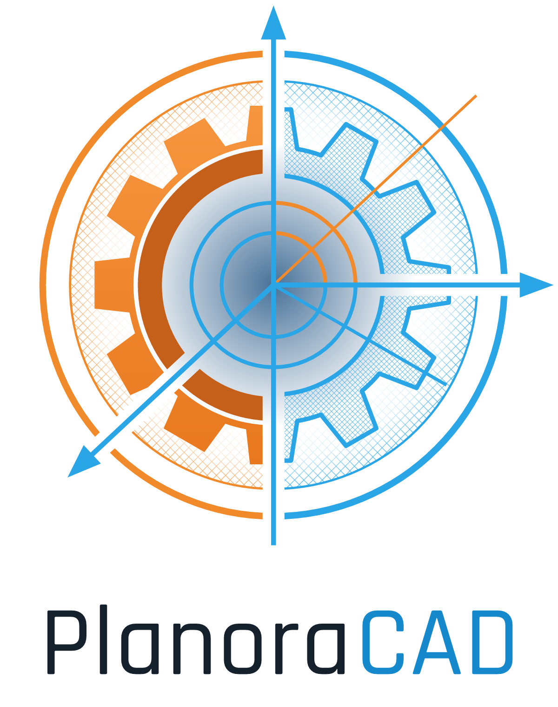
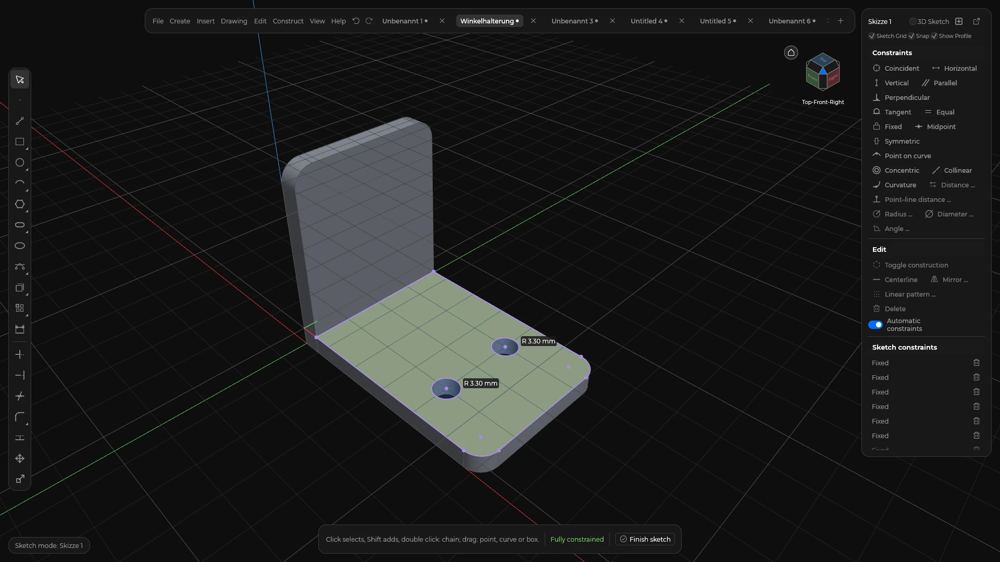
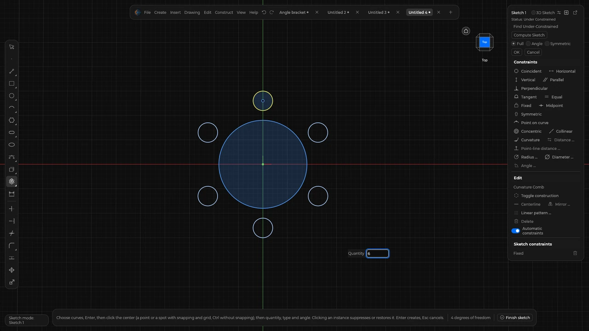
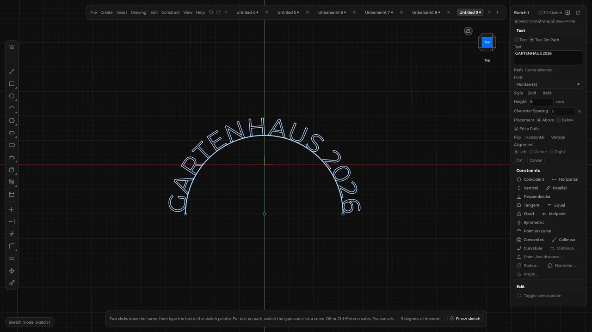
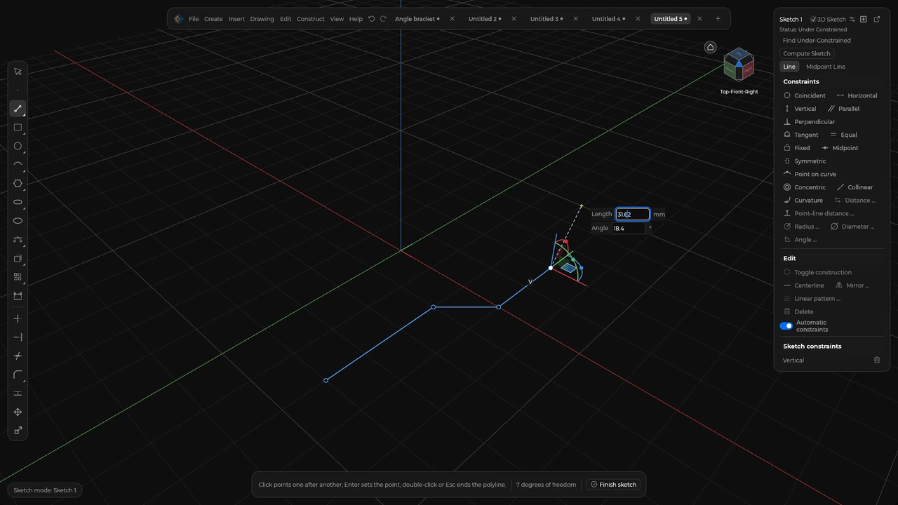
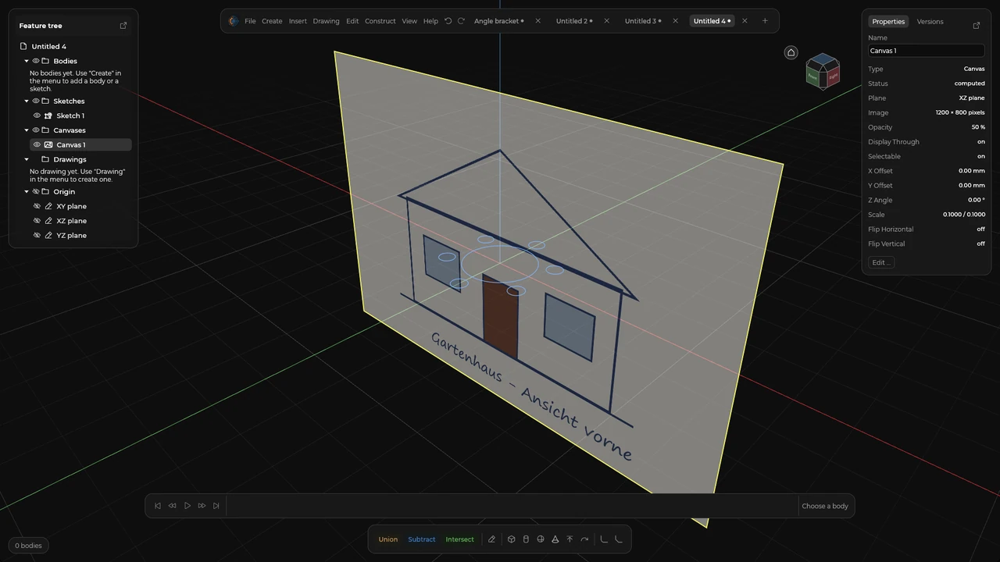
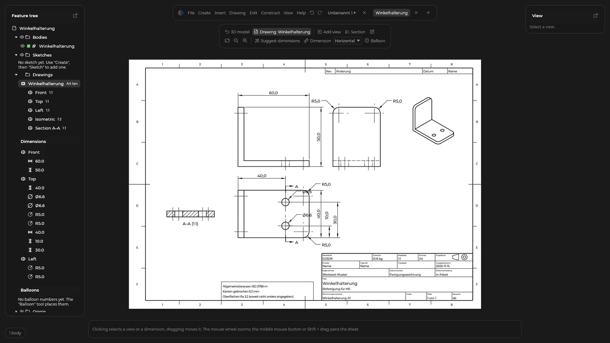
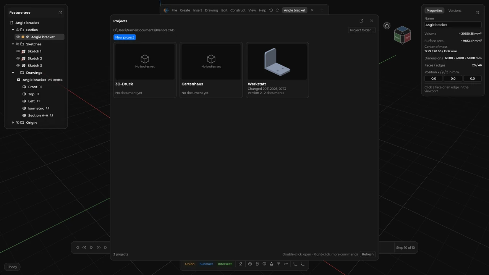

<p align="center">
  <picture>
    <source media="(prefers-color-scheme: dark)" srcset="assets/logo/planoracad-logo-fuer-dunkel.png">
    
  </picture>
</p>

<p align="center">
  <b>Free 3D CAD for Windows and Ubuntu: draw sketches, build solids, create technical drawings.</b>
</p>

<p align="center">
  <a href="https://github.com/KaelanTesseract/PlanoraCAD/releases"></a>
  <a href="LICENSE"></a>
  
  
  
</p>

<p align="center">
  <a href="README.md">Deutsch</a> · <b>English</b>
  <br>
  <a href="https://github.com/KaelanTesseract/PlanoraCAD/releases">Download</a> ·
  <a href="https://dennis-guse.de/en/planoracad/wiki/">Manual</a> ·
  <a href="https://dennis-guse.de/en/projects/planoracad.html">Project page</a> ·
  <a href="CHANGELOG.md">Changes</a> (German) ·
  <a href="https://github.com/users/KaelanTesseract/projects/1">Roadmap</a>
</p>

<p align="center">
  
</p>

PlanoraCAD is a free program for designing parts in 3D on your computer: brackets, housings, spare parts or parts for 3D printing. You draw a sketch with dimensions, turn it into a solid and derive a technical drawing from it. Every step is recorded. If you change a dimension later, the program recalculates everything that builds on it.

> [!NOTE]
> **Early test version.** The current version is `0.0.2-dev.3` (developer channel). Windows (64-bit) gets a ready-made installer; on Ubuntu you build the program yourself. It is meant for trying out, not yet for everyday work. Expect bugs and keep extra copies of important projects. All [feedback](#reporting-bugs-and-wishes) is welcome.

## Contents

- [What PlanoraCAD can do](#what-planoracad-can-do)
- [Pictures](#pictures)
- [Download and install](#download-and-install)
- [On Ubuntu](#on-ubuntu)
- [Updates and language](#updates-and-language)
- [Reporting bugs and wishes](#reporting-bugs-and-wishes)
- [What does not work yet](#what-does-not-work-yet)
- [Privacy](#privacy)
- [For developers](#for-developers)

## What PlanoraCAD can do

**Sketches**
- Start a sketch with one click: "Create Sketch" shows the origin planes to choose from, and you click a plane or a flat face.
- Draw lines, rectangles, circles, arcs, polygons, slots, ellipses, splines and conics, many of them in several ways.
- Type dimensions while you draw. Rules such as "horizontal", "parallel" or "tangent" are added automatically.
- Round corners, trim, extend and offset curves, connect two ends smoothly, move, rotate and mirror parts of a sketch.
- Copy, cut and paste, also into another sketch.
- The program shows whether a sketch is fully defined and finds what can still move.
- Rectangular and circular patterns that you can still change later.
- Text in a frame or along a curve, using the fonts on your computer. Height and content can use parameters.
- Project edges of a solid into the sketch, insert DXF and SVG files and place a photo as a template. Sketches can also be saved as DXF.
- 3D sketches: draw curves freely in space, for example a cable route.
- Organize sketches in groups and choose per sketch what is shown. Solids hide the sketch behind them, and "Slice" cuts away what is in front.

**Solids**
- Extrude sketches or revolve them around an axis. Box, cylinder, sphere and cone are built in.
- Join solids, subtract one from another or keep only the overlap.
- Round or chamfer edges.
- Parameters with formulas: dimensions get a name such as "Width = 40", and other dimensions calculate with it.
- Construction planes for sketches anywhere on the part.

**Drawings**
- Front, top, side and isometric views, plus section views.
- Dimensions, center lines, title block, parts list and balloons.
- Output as PDF, SVG or DXF.

**Exchange with other programs**
- Read and write STEP, the common format between CAD programs.
- Write STL and 3MF for 3D printing, plus OBJ and glTF. Read STL and OBJ.

**Working and staying organized**
- Projects with versions: every save creates a new version. You can go back to an old one or branch off from it.
- A timeline shows every step of a part. You can jump back to any step.
- Undo and redo for every change.
- Keyboard shortcuts like in common CAD programs, all changeable in the settings.
- Light or dark, millimeters or inches, German or English.
- Undock panels and columns into their own windows, for example on a second screen.

All the details are in the [manual](https://dennis-guse.de/en/planoracad/wiki/).

**Why PlanoraCAD?**
- **Free and open:** anyone may read, change and share the source code (GPL-3.0).
- **Your files stay with you:** no account, no cloud. Projects are ordinary folders on your computer.
- **Nothing gets lost:** old versions are kept. Every two minutes the program makes an extra backup and offers it after a crash.
- **Dimensions stay editable:** you adjust a part instead of drawing it again.

## Pictures

<table>
  <tr>
    <td width="50%"><br><sub>Circular pattern in a sketch</sub></td>
    <td width="50%"><br><sub>Text along a curve</sub></td>
  </tr>
  <tr>
    <td><br><sub>3D sketch with curves in space</sub></td>
    <td><br><sub>Picture as a template for tracing</sub></td>
  </tr>
  <tr>
    <td><br><sub>Technical drawing with section and title block</sub></td>
    <td><br><sub>Projects with preview and versions</sub></td>
  </tr>
</table>

More pictures and step-by-step guides are in the [manual](https://dennis-guse.de/en/planoracad/wiki/).

## Download and install

**What you need:** Windows 10 or 11 (64-bit) or Ubuntu, a graphics card with an up-to-date driver and a screen with at least 1920 × 1080 pixels. The steps here are for Windows. For Ubuntu, see [On Ubuntu](#on-ubuntu).

1. Open the [releases page](https://github.com/KaelanTesseract/PlanoraCAD/releases).
2. Under "Assets" of the newest version, click `planoracad-setup-x64.exe`.
3. Double-click the file.
4. Windows will probably show "Windows protected your PC". Click "More info" and then "Run anyway". The warning appears because the file is not digitally signed. So only download the program from the releases page.
5. The installer takes you through five steps: "Welcome", "License", "Folder", "Install" and "Done".
   - On "License", tick "I accept the license".
   - On "Folder", choose "Just for me" (no administrator rights, usually the right choice) or "For all users" (Windows then asks for your permission). The desktop shortcut is already ticked.
6. Click "Install" and at the end "Finish". PlanoraCAD is then in the Start menu and can start right away.

If your antivirus program holds the file or something does not start, see the [FAQ](https://dennis-guse.de/en/planoracad/wiki/faq.html). To build your first part, follow [Getting started](https://dennis-guse.de/en/planoracad/wiki/getting-started.html).

<details>
<summary><b>Uninstalling and where your data is</b></summary>

**Uninstall:** in the Windows settings under "Apps", search for "PlanoraCAD" and choose "Uninstall". Your projects, settings and logs are kept.

**Where your data is:**
- **Projects:** in the folder `Documents\PlanoraCAD`. You choose another folder under "File → Settings …" with "Change project folder …".
- **Settings, log, crash reports and feedback:** in the folder `%APPDATA%\PlanoraCAD`. Type the name into the address bar of Explorer.

If you no longer need these folders, delete them yourself after uninstalling.
</details>

### On Ubuntu

PlanoraCAD also runs on Ubuntu, and every change is checked there automatically. There is no ready-made package yet, so you build the program once from source. The first build takes a few minutes.

1. Install Rust as described on [rustup.rs](https://rustup.rs).
2. Install the required libraries:

   ```sh
   sudo apt-get update
   sudo apt-get install -y build-essential pkg-config libclang-dev libgtk-3-dev libxcb-render0-dev libxcb-shape0-dev libxcb-xfixes0-dev libxkbcommon-dev libssl-dev
   ```

3. Get the source code and start the program:

   ```sh
   git clone https://github.com/KaelanTesseract/PlanoraCAD.git
   cd PlanoraCAD
   cargo run -p planora-app --release
   ```

Differences from Windows:
- There are no updates from within the program. For a new version, fetch the latest code (`git pull`) and run the command from step 3 again.
- Projects are in `~/Documents/PlanoraCAD`, settings in `~/.config/planora-cad`.

## Updates and language

**Updates**
- On Windows, the program checks for a new version at most once a day at start. At the moment there are only developer versions (channel "Dev"). On Ubuntu you update by hand (see [On Ubuntu](#on-ubuntu)).
- If there is one, you see the changes and choose "Update now", "Later" or "Skip this version".
- With "Update now", the program downloads the new installer, checks it, asks about unsaved work and then updates itself. The new version then starts on its own.
- If something goes wrong, the previous version keeps running.
- To switch it off or check by hand: "File → Settings …", section "Updates". All changes are listed in [CHANGELOG.md](CHANGELOG.md) (German).

**Language**
- PlanoraCAD is available in German and English. On first start it uses the language of Windows, otherwise English.
- To switch: "File → Settings …", section "Appearance".
- Want to add another language? The guide is in [docs/uebersetzen.md](docs/uebersetzen.md).

## Reporting bugs and wishes

Found a bug, missing something or have a question? Please tell us. Two sentences are enough.

1. In the program, choose "Help → Feedback …" (or press Ctrl+Shift+R).
2. Choose bug, wish or question and briefly describe what happened. Checkboxes decide which details are included.
3. With a GitHub account, click "Open in browser". Without one, click "Send without a GitHub account". A form on dennis-guse.de then opens.
4. Check the details in the browser and send the form.

You can also open a [new issue](https://github.com/KaelanTesseract/PlanoraCAD/issues/new/choose) on GitHub directly. If neither works, write an e-mail to info@dennis-guse.de.

- All ways step by step and solutions for known cases: [FAQ in the manual](https://dennis-guse.de/en/planoracad/wiki/faq.html)
- Planned wishes and current work: [Roadmap](https://github.com/users/KaelanTesseract/projects/1)

Issues on GitHub are public. Please do not write anything private in them.

## What does not work yet

- A ready-made installer exists only for Windows (64-bit). On Ubuntu you build the program yourself, and there are no updates from within the program.
- No assemblies. From STEP assemblies, every solid is imported on its own.
- No loft and no sweep. Patterns and mirroring exist only in sketches, not on solids.
- Revolve only works for a full 360 degrees.
- In some cases the program refuses fillets, chamfers and combining solids. It would rather give no result than a wrong one.
- Complex calculations, especially with freeform surfaces, can take a few seconds. During that time the window does not respond.
- Colors and materials are not exchanged with other programs.
- Branches cannot be merged again.
- New versions sometimes save in a newer file format. Older versions then cannot open those files.

The limits of each feature are described in the [manual](https://dennis-guse.de/en/planoracad/wiki/).

## Privacy

- **Updates:** the program asks GitHub (`api.github.com`) for new versions at most once a day, as long as the check is switched on. To download, it connects to GitHub. It sends no projects, no names and no identifier of your computer. As with any connection, GitHub sees your IP address and the name and version of the program. If you switch the check off, the program never connects by itself.
- **Feedback:** the program sends nothing by itself. You see beforehand what will be included and can untick it. The program removes your user name, project paths and e-mail addresses first. The details are part of the form's address and therefore already go to GitHub or dennis-guse.de when the page opens in the browser (they may appear in the server log there). Nothing is stored or reported until you click "Submit" in the form.
- **Crash reports:** if the program crashes, it writes a report on your computer, without your user name. On the next start it asks whether you want to send it. It never leaves your computer without your action. Old reports are deleted after 30 days.
- **Log:** the log file stays on your computer. It contains no project content.

Responsible: Dennis Guse, Fischbeker Str. 2a, 23869 Elmenhorst, Germany. Contact: info@dennis-guse.de.

## For developers

PlanoraCAD is written in Rust (edition 2024, Rust 1.88 or newer) with its own geometry kernel. The user interface uses egui/eframe and wgpu. Code comments and developer documents are mostly in German.

### Build and check

```sh
cargo run -p planora-app --release
```

```sh
cargo fmt --all --check   # on Windows per crate: cargo fmt -p <crate> --check
cargo clippy --workspace --all-targets -- -D warnings
cargo test --workspace
cargo deny check
```

On Ubuntu you also need the libraries from [On Ubuntu](#on-ubuntu) (the same as in `.github/workflows/ci.yml`). CI checks every change on Windows and Ubuntu.

After `cargo build --release -p planora-app`, build the installer with `tools\build-installer.ps1`. It needs Inno Setup 6.7 or newer for the installation engine and embeds it in the `planora-setup` front end. The result `planoracad-setup-x64.exe` with its checksum ends up in `dist`.

### Structure

The workspace has 16 crates under `crates/`:

| Crate | Purpose |
|---|---|
| `planora-math` | Vectors, coordinate systems, tolerances, NURBS |
| `planora-kernel` | Geometry kernel (B-rep): solids, Boolean operations, fillets |
| `planora-mesh` | Tessellate solids into triangle meshes, volume and center of mass |
| `planora-exchange` | Meshes as STL, 3MF, OBJ and glTF; import DXF, SVG and images |
| `planora-step` | Read and write STEP |
| `planora-sketch` | Sketches, constraints and solver |
| `planora-text` | Read fonts and lay out text as curves |
| `planora-drawing` | Technical drawings: views, sheet, dimensions, output |
| `planora-feature` | Feature tree, stable references, recalculation |
| `planora-project` | Projects, versions, file format, settings |
| `planora-render` | Camera, picking in the viewport, rendering with wgpu |
| `planora-update` | Find, download and verify new versions |
| `planora-i18n` | Language files (Fluent) and number format |
| `planora-style` | Colors and fonts for the program and the installer |
| `planora-setup` | Installer front end that drives the Inno Setup engine |
| `planora-app` | The program: window, tools, dialogs |

### Releases and crash reports

- A new version is made with `tools\release.ps1`, a section in `CHANGELOG.md`, a green run of `ci.yml` and a tag. The tag starts `.github/workflows/release.yml`, which builds the Windows version with installer and creates the release (installer `planoracad-setup-x64.exe`, checksum, `THIRD-PARTY-LICENSES.txt` and the symbol file `.pdb`).
- `tools\symbolize.ps1` resolves crash reports from testers with the `.pdb` of the release.
- Details (German): [Updates und Versionen](docs/funktionen.md#updates-und-versionen), [Projekttafel einrichten](docs/projekttafel-einrichten.md), [open points](docs/superpowers/offene-punkte.md).

### Third-party material

Fonts: Montserrat (OFL 1.1), symbol font Phosphor (MIT), fallback font Roboto 2.138 (Apache-2.0), see `crates/planora-app/assets/fonts/`. The PDF output uses Helvetica character widths from Adobe's "Core 14 AFM Files"; the full notice is in the [German README](README.md#drittanbieter).

### License

PlanoraCAD is licensed under GPL-3.0-only, see [LICENSE](LICENSE). The licenses of all libraries come with every release as `THIRD-PARTY-LICENSES.txt`.
