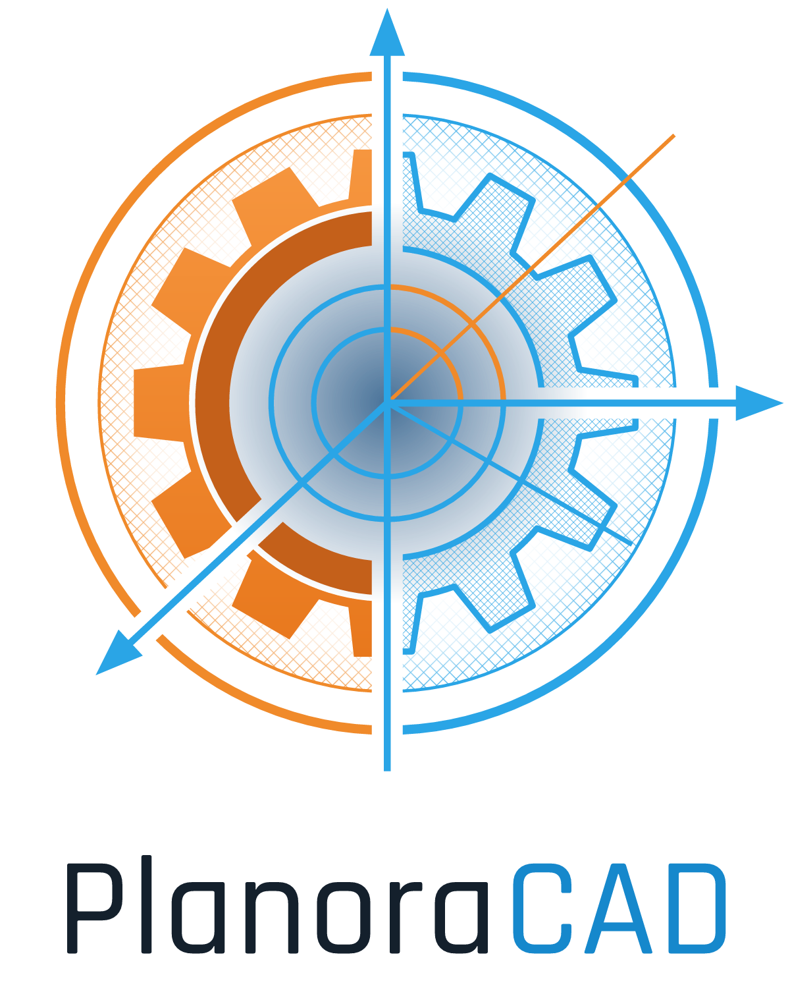

  <picture>
    <source media="(prefers-color-scheme: dark)" srcset="assets/logo/planoracad-logo-fuer-dunkel.png">
    
  </picture>

# PlanoraCAD

Ein quelloffenes, parametrisches 3D-CAD in reinem Rust für Windows und Linux.

Fehler gefunden oder einen Wunsch? Wie du etwas meldest, steht unter [So meldest du etwas](docs/so-meldest-du-etwas.md).

Hilfe bei Problemen: [Häufige Probleme](docs/haeufige-probleme.md). Was geplant ist, siehst du auf der Projekttafel: [Was geplant ist](https://github.com/users/KaelanTesseract/projects/1). Wie die Tafel eingerichtet wird: [Projekttafel einrichten](docs/projekttafel-einrichten.md).

**Status:** frühe Entwicklung (Fundament, Kernel-Basis, Boolesche Operationen, Skizzen mit Constraint-Solver, Feature-Baum, Speichern mit Projekten und Versionen, Freiformflächen, Rundungen und Fasen, Netz-Austausch, STEP-Export, STEP-Import, Zeichnungen mit Ansichten, Zeichnungsblatt, Stückliste und Positionsnummern, PDF-Ausgabe, Schnittansichten, Rückgängig und Wiederholen, benannte Parameter mit Formeln).

Erste Version: Quader, Zylinder, Kugel, Kegel, Extrusion und Rotation von Skizzen, 3D-Ansicht mit Auswahl, Körper verschieben (Feld „Position“) sowie Boolesche Operationen (Vereinigen, Abziehen, Schneiden) für Körper mit Flächen aus Ebenen, Zylindern, Kegeln, Kugeln und Tori (Stufe A) und für Körper mit Freiformflächen aus Ellipsen und Splines (siehe „Freiformflächen“).

Bekannte Grenzen: Bei Körpern aus einfachen Flächen werden Schnitte, die Raumkurven ergeben (z. B. zwei Zylinder mit gekreuzten Achsen), noch nicht unterstützt (mit Freiformflächen dagegen oft schon, siehe „Freiformflächen“); das Vereinigen von Körpern, die sich nur an einer Kante berühren, manche genau tangentialen Lagen und Kanten oder Ecken, die genau auf einer Fläche des anderen Körpers aufliegen, liefern eine Fehlermeldung statt eines Ergebnisses (bei Berührung nur an einer Ecke entsteht ein Körper aus zwei Teilen mit gemeinsamer Ecke). Details: `docs/superpowers/offene-punkte.md`.

## Skizzen

Über „Erzeugen → Skizze auf XY-/XZ-/YZ-Ebene“ oder „Skizze auf gewählter Fläche“ (ebene Fläche eines Körpers) entsteht eine Skizze. Im Skizzen-Modus schaut die Kamera senkrecht auf die Ebene; eine neue Skizze öffnet sich mittig und herangezoomt auf der Fläche oder Ebene; die Werkzeuge stehen in einer Leiste links, Abhängigkeiten und deren Liste in einem Feld rechts (siehe „Neues Aussehen“).

**Was geht**
- Zeichnen: Punkt, Linie, Rechteck, Kreis, Bogen, Ellipse, Spline; Konstruktionsgeometrie über „Konstruktion umschalten“; Spiegeln und lineares Muster.
- Abhängigkeiten: deckungsgleich, waagerecht, senkrecht, parallel, rechtwinklig, tangential, gleich, fest, Mittelpunkt, symmetrisch, Punkt auf Kurve; Maße für Abstand, Abstand Punkt–Linie, Radius, Durchmesser und Winkel (Eingabe als Zahl).
- Der eigene Solver (keine neue Bibliothek) zeigt die Freiheitsgrade an, färbt bestimmte Geometrie anders ein und meldet überzählige und widersprüchliche Abhängigkeiten. Der Solver arbeitet je zusammenhängender Gruppe: Eine Gruppe mit Widerspruch (oder die sich nicht lösen lässt) bleibt in ihrem letzten Zustand, die übrigen Gruppen werden trotzdem gelöst. Lösungen, bei denen Geometrie entartet (Radius null oder negativ, Linie der Länge null, Bogenanfang auf der Mitte), gelten nicht als Lösung; die Gruppe bleibt dann ebenfalls stehen, und die Ursache wird genannt. Eine neue Abhängigkeit, die eine gelöste Skizze kaputt machen würde, wird abgelehnt; in einer schon fehlerhaften Skizze wird sie mit Warnung behalten. Ziehen startet vom letzten Zustand, mehrdeutige Lagen klappen in der Regel nicht um.
- Körperkanten einmalig als feste Konstruktionsgeometrie in die Skizze kopieren (Geraden; Kreise und Bögen in parallelen Ebenen; ganze Kreise und Ellipsen auch schräg, dann als Ellipse).
- „Skizze beenden“ legt die Skizze als Eintrag im Feature-Baum ab; sie bleibt als dünne Linien in der 3D-Ansicht sichtbar und lässt sich per Doppelklick oder Rechtsklick → „Bearbeiten“ wieder öffnen.
- Körper aus Skizzen: Rechtsklick auf die Skizze → „Extrudieren …“ / „Drehen …“ oder „Erzeugen → Skizze extrudieren … / Skizze drehen …“. Der Dialog listet die geschlossenen Profile mit Fläche und Löchern und erklärt, warum andere Kurvenzüge nicht verwendbar sind. Das Ergebnis ist ein normaler Körper, der sich mit den Booleschen Operationen weiterverarbeiten lässt und der Skizze folgt (siehe „Feature-Baum“).

**Was (noch) nicht geht**
- Profile müssen einfache geschlossene Ketten aus Linien, Bögen und Splines sein, oder ein Kreis, eine Ellipse oder ein Spline, dessen Enden aufeinanderliegen (keine T-Verzweigungen, keine Kreuzungen, kein Zerschneiden an Schnittpunkten). Ellipsen und Splines werden seit Teilprojekt 7 zu Körpern (siehe „Freiformflächen“).
- Drehen nur für Profile ohne Löcher, die mit genau einer Linie auf der Drehachse liegen und ganz auf einer Seite davon; immer 360°.
- Skizzen nur auf den Grundebenen und auf ebenen Körperflächen.
- Kopierte Körperkanten folgen der Kante nur, solange sie ihre Art behält (eine Gerade bleibt eine Gerade).
- Maße nur als Zahl, keine Gleichungen oder Parameter.
- Mehrdeutige Lagen (z. B. ein Winkel um 180° gedreht) entscheidet der nächstgelegene Zustand; es gibt keine Auswahl der Lösung.
- Der Solver rechnet je zusammenhängender Gruppe mit dichten Matrizen. Unveränderte Gruppen werden nicht neu gerechnet (auch beim Ziehen nicht); innerhalb einer Gruppe wird flüssiges Ziehen ab etwa 150–300 Variablen zäh (300 Variablen: etwa 0,15 s je Zugschritt im Release-Build). Widersprüchliche Gruppen sind langsamer: Beim Ziehen sucht der Solver dort nicht nach der Ursache, das holt er am Ende des Ziehens nach; hat eine Gruppe mehr als 48 Abhängigkeiten, meldet er statt der genauen Ursache „nicht lösbar“ mit den verletzten Abhängigkeiten. Ein Muster mit 100 Kopien eines Rechtecks ist eine Gruppe mit über 800 Variablen (Anlegen etwa 1,7 s, Ziehen etwa 1,5 s je Schritt).
- Fertige Skizzen liegen in der 3D-Ansicht immer über den Körpern (keine Verdeckung) und lassen sich dort nicht anklicken.

Einzelheiten: `docs/superpowers/offene-punkte.md`, Abschnitt „Nach Teilprojekt 4 (Skizzen)“.

## Freiformflächen

Ellipsen und Splines aus Skizzen werden jetzt zu Körpern. Für ihre Wände baut das Programm Freiformflächen (in der Fachsprache NURBS): Flächen, die der gezeichneten Kurve genau folgen, statt sie aus Ebenen und Zylindern zusammenzusetzen.

**Was geht**
- Extrudieren: eine Ellipse, ein geschlossener Spline oder eine geschlossene Kette aus Linien, Bögen und Splines. Eine Ellipse in einem Rechteck wird zum Loch in der Platte.
- Drehen: auch Profile mit Splines, mit denselben Regeln wie bisher (ohne Löcher, eine Linie auf der Drehachse, immer 360°). Eine Ellipse allein lässt sich nicht drehen, weil sie keine Linie auf der Achse hat.
- Vereinigen, Abziehen und Schneiden funktionieren auch mit solchen Körpern und auch zwischen zwei Freiformkörpern (zum Beispiel zwei sich kreuzende Walzen verschiedener Dicke). Durch Tests geprüft ist das vor allem zusammen mit Quadern und Zylindern; mit Kugeln und Kegeln ist bisher nur das Berechnen der Schnittlinien geprüft.
- Änderst du ein Maß der Ellipse oder einen Punkt des Splines, rechnen sich Extrusion, Drehung und alle Booleschen Operationen danach neu.
- Speichern und Öffnen wie bisher. Das Dateiformat hat sich nicht geändert.
- Im Eigenschaftenfenster heißt eine solche Fläche „Freiformfläche“ und eine solche Kante „Freiformkurve“.

**Grenzen**
- Manche Lagen kann das Programm mit Freiformflächen nicht sicher berechnen. Dann steht am Schritt im Feature-Baum eine Meldung, die den Hinweis „Bei Körpern mit Freiformflächen:“ enthält; die Körper davor bleiben, wie sie waren, und Schritte, die darauf aufbauen, werden übersprungen. Oft hilft es, einen Körper ein wenig zu verschieben oder ein Maß leicht zu ändern. Typische Fälle:
  - Flächen, die sich nur berühren oder sehr flach schneiden (Meldung „nahezu tangential“ oder „berühren sich“),
  - zwei gleich dicke Walzen aus Freiformflächen, die sich kreuzen (an der Stelle, wo sich beide Schnittlinien treffen, kann das Programm nicht rechnen),
  - sehr dünne Stellen im Ergebnis, dünner als etwa 0,0001 mm (ein zehntausendstel Millimeter),
  - Freiformkörper, die winzig klein sind (unter etwa 0,00002 mm),
  - zwei Freiformflächen, die nur teilweise genau aufeinanderliegen.
- Selten fehlt beim Verschneiden ein ganz kurzes Stück einer Schnittlinie, ohne dass eine Meldung kommt. Meist merkt die Prüfung des fertigen Körpers das und meldet einen Fehler, aber nicht immer: In seltenen Fällen kann das Ergebnis einer Booleschen Operation mit Freiformflächen falsch sein.
- Schnittlinien mit Freiformflächen sind Näherungen. Sie weichen höchstens 0,00001 mm (ein hunderttausendstel Millimeter) von den Flächen ab; das ist für die Darstellung und für Maße ohne Bedeutung.
- Boolesche Operationen mit Freiformflächen dauern länger als mit einfachen Flächen: im Release-Build meist eine halbe bis eine Sekunde. Körper aus Splines mit vielen Punkten (etwa ein gedrehter Spline mit 39 Punkten, mit einem Zylinder verschnitten) brauchen oft mehrere Sekunden, in Tests bis etwa 16 Sekunden. Damit das nicht beliebig lange dauert, hat jede solche Operation eine feste Arbeitsgrenze; wird sie erreicht, kommt die Meldung „Die Berechnung ist zu aufwendig“, und das Dokument bleibt, wie es war. Das kann auch Lagen treffen, die eigentlich lösbar wären. Während der Rechnung reagiert das Fenster nicht, auch beim Öffnen eines Dokuments mit solchen Schritten.
- Das Bildschirmnetz kann bei seltenen Ergebnissen winzige Lücken haben, vor allem an sehr schmalen Streifen bei grober Netzgenauigkeit. Zwei Ursachen sind behoben (Quader auf der Stirnfläche eines Zylinders; doppelt belegte Stücke an Freiformflächen). In den Testreihen mit gedrehten Quadern gegen einen Freiformzylinder (über 6000 Ergebnisse) gab es danach keine Lücken mehr. Ohne Freiformflächen bleiben seltene Fälle bei grober Netzgenauigkeit: In einer Stichprobe von 200 Ergebnissen ließen sich zwei bei 0,05 gar nicht vernetzen (mit Meldung), eines hatte bei 0,1 bis 0,01 eine kleine Lücke. Ältere Prüfungen hatten 0,5 bis 2 von 100 Ergebnissen gemeldet; deren Testreihen lagen nicht mehr vor. Der Körper selbst ist davon nicht betroffen. Erkennt das Programm, dass das Netz eines Körpers an einzelnen Stellen ungenau ist, zeigt die Statuszeile einen Hinweis (wenn dort keine andere Meldung steht).
- **Alte Dokumente:** Ellipsen und Splines bekommen jetzt eine Profilnummer, vorher wurden sie übergangen. Eine Extrusion oder Drehung merkt sich ihr Profil nur als Nummer. Deshalb kann ein altes Dokument mit Ellipsen oder Splines in der Skizze beim Öffnen ein anderes Profil verwenden als früher, eine Platte kann ein Loch bekommen, oder es erscheint ein Fehler „Profil 0 gibt es nicht“.
- Kontrollpunkte von Freiformflächen lassen sich nicht direkt bearbeiten; Loft und Sweep gibt es noch nicht.

**Handprüfung:** Am 12.10.2026 von Hand im echten Fenster geprüft (Release-Build): Ellipse auf der XY-Ebene skizzieren und extrudieren (Profilfläche 633,30 mm², Volumen etwa 6327 mm³, die Fläche heißt im Eigenschaftenfenster „Freiformfläche“), Zylinder anlegen und über „Position“ verschieben, Abziehen (Zylinder minus Ellipsenkörper: 7 Flächen, 15 Kanten, 16 110 mm³), Mittelpunkt der Ellipse in der Skizze ziehen (der Körper rechnet sich neu: 16 341,67 mm³), in ein Projekt speichern, Programm hart beenden, neu starten, die zurückgebliebene Sperre mit „Sperre übernehmen“ übernehmen und das Dokument öffnen (gleiche Form, gleiches Volumen, gleiche 7 Flächen). Ein Spline in einer Skizze auf der XZ-Ebene, mit einer Linie geschlossen, die den Spline kreuzt: Die Oberfläche meldet richtig „Nicht verwendbar: Das Profil schneidet oder berührt sich selbst oder ein anderes Profil“. Nicht von Hand geprüft (nur durch automatische Tests ohne Fenster): Extrusion oder Drehung eines gültigen Splines im Fenster, Skizze auf einer Körperfläche, Ändern der Halbachsen-Maße, Arbeitsgrenze und Einfrieren des Fensters, der Netz-Hinweis in der Statuszeile. Dabei aufgefallen: Für eine Ellipse gibt es in der Skizzen-Oberfläche noch keine Maß-Eingabe (Radius, Durchmesser und Abstand sind ausgegraut).

Einzelheiten: `docs/superpowers/offene-punkte.md`, Abschnitt „Teilprojekt 7 – NURBS (Freiformkurven)“.

## Rundungen und Fasen

Kanten eines Körpers lassen sich runden oder abschrägen (Menü „Bearbeiten“ → „Verrunden …“ bzw. „Fase …“). Im Fenster die Kante in der Ansicht anklicken; mit gedrückter Umschalttaste kommen weitere Kanten dazu, ein zweiter Klick nimmt eine Kante wieder heraus. Ist „Tangentenkette“ eingeschaltet, werden Kanten, die glatt anschließen (etwa rund um ein Langloch), automatisch mitgenommen.

- **Rundung:** fester Radius oder variabler Radius über Punkte entlang der Kante (Position in Prozent, Radius); dazwischen ändert sich der Radius glatt und ohne Überschwingen.
- **Fase:** gleicher Abstand auf beiden Flächen, zwei Abstände (Fläche 1 und Fläche 2) oder Abstand und Winkel.
- Treffen zwei gerundete Kanten an einer Ecke zusammen, laufen die Rundungen schräg ineinander; drei gerundete Kanten mit gleichem Radius an einer Ecke aus drei ebenen Flächen bekommen ein Kugelstück.
- Fälle, die das Programm nicht sicher rechnen kann, werden mit einer Meldung abgelehnt, zum Beispiel ein Radius, der größer ist als die Fläche daneben, oder Flächen, die fast glatt ineinander übergehen. Im Zweifel lehnt das Programm lieber ab, als einen falschen Körper zu liefern.
- Vor der Ausgabe wird das Ergebnis geprüft: Der Körper muss geschlossen und gültig sein, keine Kante einer anderen Fläche darf durch die neue Fläche laufen, Löcher in den Nachbarflächen werden berücksichtigt, und jede Fläche, die der neuen Fläche nahekommt, wird mit ihr geschnitten. Lässt sich dieser Schnitt nicht genau rechnen (etwa bei einer Kugel und einem Zylinder mit verschiedenen Achsen), kommt eine Meldung. Ganz ausgeschlossen ist ein falscher Körper damit nicht; die bekannten Lücken stehen unten unter „Grenzen“.

Rundungen stehen wie alle Schritte in der Zeitleiste, lassen sich nachträglich ändern, unterdrücken und löschen. Dokumente mit Rundungen oder Fasen speichert das Programm im Dateiformat 2; ältere Programmversionen melden dann „zu neu“. Dokumente ohne Rundung bleiben im Format 1.

**Grenzen**
- Körper mit Hohlräumen oder mehreren getrennten Teilen lassen sich noch nicht runden oder fasen.
- An Ecken ist vieles noch nicht möglich. Zwei gerundete Kanten laufen nur dann sauber ineinander, wenn ihre Seiten spiegelgleich liegen. Drei Rundungen mit gleichem Radius bekommen ein Kugelstück. Nicht möglich sind Ecken mit variablem Radius oder an Freiformflächen, Ecken, die nach innen springen, drei Fasen an einer Ecke und sehr spitze Ecken. Die Ecken-Stile „Setback“ und „glatte Ecke“ gibt es noch nicht.
- Sehr kleine Maße lehnt das Programm ab: unter 0,0001 mm, bei Freiformflächen oder variablem Radius unter 0,002 mm. Fasenwinkel gehen von 1° bis 179°.
- Ein Teil der Anfragen wird abgelehnt, auch wenn er sich theoretisch rechnen ließe. In unseren Zufallstests waren es bei Quadern etwa 9 von 100 Anfragen (bei einzelnen Kanten), bei Zylindern etwa 70 von 100, bei Kegeln etwa 84 von 100. Mehrere Kanten, Ecken und Körper mit Löchern werden öfter abgelehnt; es steht immer eine Meldung dabei.
- Boolesche Operationen (Vereinigen, Abziehen, Schneiden) mit einem gerundeten Körper werden oft abgelehnt, vor allem, wenn dabei Kegel- oder Ringflächen aus einer Rundung getroffen werden.
- Bei steil verlaufenden variablen Radien kann das Bildschirmnetz sehr kleine Lücken haben (in etwa 1 von 100 Fällen); der Körper selbst ist in Ordnung, die Statuszeile zeigt dann „Netz ungenau“. Bei Rundungen an Freiformflächen ist das Netz bei grober Einstellung bis zu einigen Prozent im Volumen ungenau.
- Eine kleine Rundung, die ein Teil des Körpers wegnimmt oder hinzufügt, prüft das Programm auf Plausibilität. Fehlt dabei nur die kleinere Art (bis etwa ein Fünftel), fällt das nicht auf; das Ergebnis ist dann geometrisch geprüft, aber nicht zusätzlich über das Volumen.
- Was die Prüfung nicht abdeckt: Bei zwei Flächen, die schon eine Ecke oder Kante gemeinsam haben, sucht das Programm keinen weiteren Schnitt, wenn es ihn nicht genau rechnen kann. Bei den beiden Flächen direkt an der gerundeten Kante verlässt es sich auf die Bauweise und die Krümmungsprüfung. Eine solche Lücke ist in den Tests bisher nicht aufgefallen, aber auch nicht ausgeschlossen. Bis Oktober 2026 gab es eine weitere: Eine Kugeltasche, die sich von innen bis in die Rundung wölbte, ohne dass ihre Kanten die Rundung trafen, wurde übersehen und ergab einen falschen Körper. Das ist behoben; solche Fälle werden jetzt abgelehnt.
- Die Kantenverweise im Schritt werden nach einer Neuberechnung nicht aktualisiert; „Fläche 1“ wird über den Flächennamen gewählt und wirkt bei zwei gleich benannten Flächen nicht. Der Hinweis zum Mindestmaß erscheint erst, nachdem eine Kante gewählt ist.

Einzelheiten und Messwerte: `docs/superpowers/offene-punkte.md`, Abschnitt „Teilprojekt 8 – Rundungen und Fasen“.

## Netz-Austausch (Export und Import)

Körper lassen sich als Dreiecksnetz speichern, etwa für den 3D-Druck oder um sie in einem anderen Programm anzusehen: Menü „Datei“ → „Exportieren …“ (Strg+Umschalt+E).

- **Formate:** STL (für den 3D-Druck), OBJ (für viele 3D-Programme), 3MF (für den 3D-Druck, mit dem Namen jedes Körpers) und glTF als .glb (zum Ansehen und Zeigen).
- **Qualität:** Grob, Normal oder Fein. Gewölbte Flächen werden aus kleinen Dreiecken zusammengesetzt. Bei „Fein“ weicht das Netz höchstens ein tausendstel Millimeter von der echten Fläche ab; die Datei wird dafür größer. Das Fenster zeigt vorher, wie viele Dreiecke es werden und wie groß die Datei ungefähr wird.
- **Umfang:** Ist ein Körper gewählt, nur dieser; sonst alle sichtbaren Körper. Unterdrückte Schritte zählen nicht.
- **Prüfung:** Ist das Netz nicht ganz geschlossen (das kann bei Körpern mit Freiformflächen und bei eingelesenen Netzen mit Rundungsresten vorkommen), warnt das Fenster. Die Datei wird trotzdem geschrieben.
- Das Programm schreibt zuerst in eine Hilfsdatei. Eine vorhandene Datei wird erst ersetzt, wenn alles geklappt hat.

Netze aus anderen Programmen lassen sich einlesen: „Datei“ → „Netz importieren …“ (STL und OBJ). Das Fenster zeigt vorher, wie viele Dreiecke die Datei hat und ob das Netz geschlossen ist. Die Einheit der Datei lässt sich wählen (Millimeter, Zentimeter, Meter, Zoll). Das Ergebnis ist ein **Netz-Körper**: Er lässt sich anzeigen, verschieben, drehen, vergrößern oder verkleinern, messen und wieder exportieren. Mit anderen Körpern verrechnen, runden oder als Fläche für eine Skizze nutzen lässt er sich nicht; diese Menüpunkte sind dann ausgegraut.

Die Dateiauswahl (beim Importieren und Exportieren) zeigt Ordner mit einem Ordnersymbol (Doppelklick öffnet sie) und hat über der Liste Knöpfe für Dokumente, Downloads, Desktop, Bilder, das Projektverzeichnis, die Laufwerke und eigene Favoriten; einen Ordner macht man mit einem Rechtsklick zum Favoriten und entfernt ihn ebenso wieder. Dieselbe Auswahl gibt es in den Einstellungen, um das Projektverzeichnis zu wählen; dort zeigt sie nur Ordner.

Dokumente mit Netz-Körpern speichert das Programm im Dateiformat 3; das Netz steckt im Dokument selbst. Ältere Programmversionen melden dann „zu neu“. Dokumente ohne Netz-Körper bleiben im Format 1 oder 2.

**Grenzen**
- Höchstens 50 Millionen Dreiecke und 8 GB je Datei. Das schützt nicht vor Speichermangel: Zum Laden braucht das Programm ungefähr das Dreifache der Dokumentgröße an Arbeitsspeicher; ein einzelnes Netz hat höchstens etwa 2,4 GB Netzdaten und braucht beim Laden rund 13 GB Spitze; bei 8 GB Netzdaten im Dokument sind es bis etwa 35 GB. Ab 5 Millionen Dreiecken zeigt die Ansicht nur einen Teil der Dreiecke; gespeichert und exportiert wird alles.
- Das Netz steckt als Text im Dokument; das Dokument wird dadurch etwa ein Drittel größer als die reinen Netzdaten und lädt bei großen Netzen langsamer. Bei Netzen um 5 Millionen Dreiecke wird auch die Ansicht spürbar langsam, weil sie nach jeder Änderung am Dokument neu aufgebaut wird.
- Farben, Materialien und Texturen werden nicht übernommen. 3MF-Dateien über 4 GB kann das Programm nicht schreiben (dann STL wählen); bei glTF gilt dieselbe Grenze.
- In OBJ-Dateien führen Vielecke, die sich nicht sauber in Dreiecke zerlegen lassen, und Flächen, die auf später stehende Punkte verweisen, zu einer Meldung mit Zeilennummer. Ein Vieleck, das nicht gewölbt nach außen liegt, darf höchstens 5000 Ecken haben. Sehr fein gerundete Einzel-Vielecke mit mehr Ecken werden deshalb abgelehnt.
- Eine Binärdatei, die mit dem Wort „solid“ beginnt, aber eine falsche Größe hat, wird als Text gelesen; die Meldung dazu ist dann irreführend.
- Wird das Dokument geändert, während das Fenster „Netz importieren“ offen ist, verwirft es die gelesene Datei; sie muss dann neu gewählt werden.
- Zum Wählen der Datei hat das Programm ein eigenes Fenster mit Ordnerliste und Dateiname; der Dateidialog des Betriebssystems wird nicht benutzt, weil dafür ein zusätzliches Programmpaket nötig wäre. Unter Windows wechselt man das Laufwerk, indem man den Pfad eintippt. Sehr große Ordner und Netzlaufwerke können das Fenster kurz hakeln lassen.
- Während das Netz berechnet oder eine Datei gelesen wird, bleibt das Fenster bedienbar. „Abbrechen“ wirkt beim Export zwischen zwei Körpern; ein einzelner großer Körper wird noch zu Ende gerechnet.
- Nicht dabei: das Einlesen von 3MF und glTF. STEP-Dateien liest der STEP-Import (siehe „STEP-Import“). (Zeichnungen als SVG/DXF gibt es seit Teilprojekt 11, siehe „Zeichnungen“.)
- Von Hand im echten Fenster ist der Netz-Austausch teilweise geprüft (Export, Import, Speichern und Laden); Abbrechen, sehr große Netze und das Öffnen der Dateien in fremden Programmen nicht. Siehe „Handprüfung“ in den offenen Punkten.

Einzelheiten: `docs/superpowers/offene-punkte.md`, Abschnitt „Teilprojekt 9 – Netz-Austausch“.

## STEP-Export (exakte Körper)

Körper lassen sich als STEP-Datei speichern. Andere CAD-Programme öffnen sie als echte Volumenkörper, nicht als Dreiecksnetz: Menü „Datei“ → „Exportieren …“ (Strg+Umschalt+E), Format „STEP – für andere CAD-Programme (exakt)“.

- Rundungen, Bohrungen und Freiformflächen bleiben exakt. Deshalb gibt es bei STEP keine Auswahl der Qualität.
- Mehrere Körper kommen in eine Datei, jeder als eigenes Teil mit seinem Namen aus dem Feature-Baum. Ein Körper mit Hohlraum bleibt ein Körper mit Hohlraum; getrennte Stücke eines Körpers bleiben ein Teil.
- Eingelesene Netz-Körper kann STEP nicht aufnehmen. Das Fenster nennt sie mit Namen; für sie STL, OBJ, 3MF oder glTF wählen.
- Vor dem Schreiben prüft das Programm jeden Körper. Wer die Prüfung nicht besteht, wird ausgelassen und mit Grund genannt; die anderen werden geschrieben.
- Das Fenster zeigt vorher, wie viele Körper und Flächen es werden. Das Schreiben läuft im Hintergrund mit Fortschrittsbalken und lässt sich abbrechen. Eine vorhandene Datei wird erst ersetzt, wenn alles geklappt hat.

**Grenzen**
- In der Datei stehen nur Form, Namen und die Einheit Millimeter; keine Farben, Materialien oder Baugruppen. STEP-Dateien einlesen geht seit dem STEP-Import (nächster Abschnitt).
- **Fusion 360:** Alle Beispieldateien lassen sich dort ohne Fehler öffnen; bei Kugel und Hohlkörper stimmen Volumen und Oberfläche mit den erwarteten Werten überein. Bei den übrigen wurden sie dort noch nicht verglichen. Beim Bauen prüft das Programm seine Dateien nur mit einem eigenen Leser und eigenen Formeln. Andere Programme können strenger sein als Fusion 360.
- Beendet man das Programm oder schließt man den Tab, während eine STEP-Datei geschrieben wird, wird das Schreiben abgebrochen und die alte Datei bleibt unverändert (ohne Meldung).
- Ringe aus einer Drehung, bei denen der Bogen die Drehachse berührt oder überschreitet (sogenannte Spindelringe), kann das Programm noch nicht als STEP ausgeben. Solche Körper werden ausgelassen und mit Grund genannt.
- Kugeln und Kegelspitzen werden so geschrieben, wie es viele Programme tun: Der Pol ist ein Eckpunkt, die Naht läuft hin und zurück. Falls ein Programm das nicht mag, wird die Kugel später in zwei Hälften geteilt.
- Körper mit mehreren Schalen braucht das Programm zum Unterscheiden von Hohlraum und Stück ein grobes Netz; lässt es sich nicht berechnen, wird der Körper mit Grund ausgelassen. Bei verschachtelten Hohlräumen kann ein Hohlraum, der sehr nah (unter 0,05 mm) an einer gekrümmten Fläche der inneren Insel beginnt, falsch zugeordnet werden; das ist sehr unwahrscheinlich.
- Namen über 256 Zeichen werden in der Datei gekürzt; das Fenster nennt sie nach dem Schreiben. Gibt man „.stp“ ein, wird daraus „.step“; Dateien mit „.stp“ stehen aber nicht in der Liste. Zwei Körper mit gleichem Namen werden zwei Teile mit demselben Namen. Bei Körpern mit vielen Hohlräumen dauert die Zuordnung länger.

Einzelheiten: `docs/superpowers/offene-punkte.md`, Abschnitt „Teilprojekt 10 – STEP-Export“.

## STEP-Import (exakte Körper)

Teile aus anderen CAD-Programmen lassen sich als echte Volumenkörper einlesen: Menü „Datei“ → „STEP importieren …“ (direkt unter „Netz importieren …“). Das Ergebnis ist ein ganz normaler exakter Körper, benannt nach der Datei oder „STEP-Körper n“. Man kann ihn abziehen, vereinigen, verrunden, verschieben, als Fläche für eine Skizze nutzen, in Zeichnungen und in der Stückliste zeigen und wieder als STEP ausgeben. Seine eigene Form lässt sich nicht über Maße ändern; „Bearbeiten …“ tut bei ihm nichts. Umbenennen geht im Feature-Baum.

**Das Fenster**
- Oben steht „Datei wählen (STEP)“ mit dem Dateinamen und dem Knopf „Andere Datei wählen …“. Das Programm liest die Datei im Hintergrund („Die Datei wird gelesen …“) und prüft dann jeden Körper („Die Körper werden geprüft …“). Beides zeigt einen Fortschrittsbalken und lässt sich mit „Abbrechen“ beenden. Eine offene Skizze beendet das Programm, bevor das Fenster aufgeht.
- Darunter steht die Liste „Körper“ über die ganze Breite: Name, Flächen, Größe (Maße der Hülle), Einheit und Status. Der Status ist „wird übernommen“, „wird übernommen – {Warnung}“ oder „wird ausgelassen: {Grund}“. Jeder Körper hat ein Häkchen; ausgelassene sind gesperrt.
- „Einheit der Datei“: Millimeter, Zentimeter, Meter oder Zoll. Vorgabe ist die Einheit, die in der Datei steht. Wählt man eine andere, werden alle Körper neu berechnet, und die Größen in der Liste ändern sich. Nennt die Datei keine oder verschiedene Einheiten, steht ein Hinweis im Fenster.
- „Importieren“ legt die angehakten Körper an. Das ist **ein** Schritt; Strg+Z nimmt alle zusammen zurück. Danach passt die Kamera auf die neuen Körper, der erste ist gewählt, und die Meldung nennt, wie viele Körper importiert und wie viele ausgelassen wurden. Warnungen zu einzelnen Körpern stehen nur vor dem Import in der Liste.
- Hat sich das Dokument zwischen Dateiwahl und „Importieren“ geändert, wird nichts angelegt. Das Fenster bittet dann, die Datei noch einmal zu wählen.

**Was gelesen wird**
- STEP-Textdateien (`.step`, `.stp`) nach AP203, AP214 und AP242. Aus AP242 zählt nur die Form.
- Körper und Körper mit Hohlräumen. Besteht ein Körper aus zwei getrennten Stücken, bleibt er ein Körper.
- Flächen: Ebenen, Zylinder, Kegel, Kugeln, Ringflächen (Torus), Freiformflächen (auch mit Gewichten, mit und ohne Knotenliste) sowie Dreh- und Strangflächen. Eine Dreh- oder Strangfläche wird, wo es genau geht, zu Ebene, Zylinder, Kegel, Kugel oder Torus, sonst zu einer Freiformfläche.
- Kanten: Geraden, Kreise, Ellipsen und Freiformkurven.
- Jeder gelesene Körper wird einmal mit dem eigenen STEP-Schreiber des Programms geschrieben und wieder gelesen; benutzt wird genau dieses Ergebnis. Körper, die der Schreiber nicht ausgeben kann (zum Beispiel Kegel, die über ihre Spitze hinausreichen), werden mit Grund ausgelassen.
- Jede Fläche bekommt eine Marke „STEP-Fläche 1“, „STEP-Fläche 2“ … in der Reihenfolge des eigenen, geprüften STEP-Texts des Körpers (nicht unbedingt in der Reihenfolge der Originaldatei). Damit gehören Skizzen und Rundungen auch nach dem Speichern und Öffnen zur selben Fläche.
- Der Name ist der Produktname aus der Datei, sonst der Name der Darstellung. Gleiche Namen werden zu „Name (2)“, „Name (3)“ …; fehlt ein Name, heißt der Körper „STEP-Körper 1“, „STEP-Körper 2“ …

**Baugruppen**
- Jeder Körper einer Baugruppe wird einzeln übernommen, und zwar an der Stelle (Lage und Drehung), die in der Datei steht. Die Gliederung der Baugruppe (Unterbaugruppen, Stücklistenstruktur) wird nicht übernommen.
- Ein Teil, das die Baugruppe mehrmals benutzt, ergibt mehrere Körper, jeder an seiner Stelle.
- Lässt sich die Lage eines Körpers nicht sicher bestimmen, bleibt er am Ursprung, und die Liste nennt den Grund. Das gilt bei Spiegelung, bei Maßstab ungleich 1, bei deutlich schiefen Achsen (leicht schiefe, wie sie durch gerundete Zahlen entstehen, richtet das Programm wie die Norm gerade), bei Verweisen im Kreis und bei mehr als 32 Ebenen Verschachtelung. Die Regeln für die Achsen folgen der veröffentlichten Fassung der Norm (ISO 10303-42); wo das Programm abweicht, meldet es das und legt den Körper an den Ursprung, statt zu raten. Sagt die Datei nicht, welches Teil das übergeordnete ist, wird die wahrscheinliche Lage angewandt und das gemeldet.
- Ist eine Lagenangabe so beschädigt, dass nicht zu erkennen ist, welcher Körper sich bewegt, wird die ganze Datei abgelehnt; das Programm rät dann nicht.

**Einheiten**
- Die Einheit steht in der Datei (Millimeter, Zentimeter, Meter, Zoll, auch selbst definierte Einheiten, die darauf beruhen) und wird in Millimeter umgerechnet. Winkel in Grad oder Bogenmaß werden richtig gelesen.
- Die im Fenster gewählte Einheit ersetzt die der Datei für **alle** Körper. Das hilft, wenn die Datei falsch beschriftet ist.

**Genauigkeit der Datei**
- STEP-Dateien tragen eine Genauigkeit, oft 0,001 mm. Das Programm selbst rechnet mit 0,000001 mm. Ecken und Kanten, die innerhalb der Genauigkeit der Datei zusammentreffen, werden zusammengezogen. Lücken, die größer sind als die Genauigkeit der Datei, schließt das Programm **nicht**; der Körper wird ausgelassen („Lücke von … mm …“).
- Ist die Genauigkeit gröber als 0,00001 mm oder steht keine in der Datei, wird der Körper übernommen, aber mit der Warnung „Rechnen mit diesem Körper kann scheitern“. Steht keine in der Datei, heißt es „Genauigkeit der Datei unbekannt (angenommen 0,001 mm)“, und gerechnet wird mit 0,001 mm. Sie steht in der Liste und im Eigenschaftenfeld des Körpers. In den Tests der Entwicklung gelangen Abziehen, Verrunden und Schnitte auch mit grober Genauigkeit; wo der Kernel einen Körper nicht rechnen kann, nennt er den Grund und rechnet nichts Falsches aus.

**Was ausgelassen wird und warum**
- **Flächenmodelle, offene Schalen, einzelne Flächen und Körper aus Dreiecken** (`OPEN_SHELL`, `SHELL_BASED_SURFACE_MODEL`, `FACETED_BREP`): Sie schließen kein Volumen ein, mit dem sich rechnen ließe. Die Meldung sagt, welche Art die Datei enthält.
- **Farben, Materialien, Ebenen, Toleranzen und Bemaßung (PMI):** Das Programm liest nur die Form.
- **Flächenarten und Kurven, die es noch nicht kann** (`OFFSET_SURFACE`, `DEGENERATE_TOROIDAL_SURFACE`, Polylinien, Parabeln, Hyperbeln): Der Körper wird mit „… wird noch nicht unterstützt“ ausgelassen.
- **Ringflächen ohne Naht:** Ein Torus, der rundum geht, ohne dass eine Kante ihn aufteilt, lässt sich nicht verarbeiten. Der Körper wird ausgelassen. Dasselbe gilt für andere Flächenarten, die rundum gehen und keine Naht haben; nur Zylinder, Kegel und Kugel ergänzt das Programm selbst.
- **Drehflächen aus einer schrägen Geraden** (die Gerade liegt weder parallel noch senkrecht zur Achse und schneidet sie nicht): „Eine Drehfläche aus einer schrägen Geraden wird noch nicht unterstützt.“
- **Verdreht oder nicht eindeutig:** Findet das Programm in einem Körper eine Fläche, deren Seite nicht zum Rest passt, wird er ausgelassen, statt still anders zu erscheinen. Das ist Absicht: Lieber fehlt ein Körper mit Begründung, als dass ein falscher im Modell steht.
- Gepackte Dateien (`.stpz`) und die XML-Form von AP242.

**Speichern in der Projektdatei**
- Die Form jedes STEP-Körpers steht in der Projektdatei selbst, nicht als Verweis auf die Originaldatei. Das Programm speichert dafür den eigenen, geprüften STEP-Text des Körpers und liest ihn beim Öffnen wieder.
- Dokumente mit STEP-Körpern speichert das Programm im Dateiformat 10. Ältere Programmversionen lehnen sie als „zu neu“ ab. Dokumente ohne STEP-Körper bleiben unverändert und lassen sich weiter mit älteren Versionen öffnen.
- Der Text steht in **jeder** gespeicherten Version noch einmal; er braucht grob 1 KB je Fläche. Alle STEP-Formen eines Dokuments zusammen dürfen höchstens 200 MB groß sein. Passt ein Import nicht mehr hinein, lehnt das Programm ihn ganz ab („Die STEP-Formen im Projekt sind zusammen zu groß …“); beim Speichern gibt es eine eigene, ähnliche Meldung.
- Lässt sich der gespeicherte Text einer Form beim Öffnen nicht mehr lesen, lädt das Dokument trotzdem; nur dieser Körper steht mit Fehlermeldung im Baum. Ist der Kopf des Textes beschädigt, gilt die ganze Version als beschädigt, und das Programm fällt auf die nächstältere lesbare zurück.

**Grenzen**
- Die Datei darf höchstens 200 MB groß sein, höchstens 5 Millionen Einträge haben und höchstens 50 Körper enthalten (gezählt wird jedes Vorkommen). Bei mehr als 50 Körpern wird die ganze Datei abgelehnt („Die Datei enthält mehr als 50 Körper.“). Ein Körper darf höchstens 20 000 Flächen haben; hat einer mehr, wird nur dieser ausgelassen. Namen werden auf 64 Zeichen gekürzt.
- Dateien, die kein STEP sind, abgeschnitten sind, Verweise im Kreis oder doppelte Nummern haben, ergeben eine Meldung mit Zeilennummer. Das Programm stürzt dabei nicht ab.
- **Die Prüfung der Körper ist eine Stichprobe.** Das Programm prüft an Probepunkten, ob jede Fläche zum Körper passt. Wände, die dünner als etwa 0,1 mm sind, und Überlappungen unter etwa 0,1 mm bleiben ungeprüft oder fallen nur zufällig auf. Manche Fehler in der Datei beschreiben außerdem einen anderen, aber gültigen Körper, etwa eine Kugelmulde mit umgekehrter Seite; das lässt sich nicht erkennen. Nach innen gekehrte Dateien mit Kugelstücken, die genau einen Pol berühren, lehnt das Programm als „nicht eindeutig“ ab.
- **Laden dauert bei gekrümmten Körpern bis etwa eine halbe Sekunde je Körper** (gemessen: Freiform-Vase 0,07 s, dieselbe Vase 100- und 1000-mal so groß je 0,12 s) und läuft in der Oberfläche; das Programm steht dann kurz. Große Körper prüft das Programm mit einem Netz, dessen Feinheit mit der Größe wächst; bei sehr großen Körpern bleiben darum auch etwas dickere Wände als 0,1 mm ungeprüft (bei 10 m Größe etwa 10 mm). Ungünstige, aber gültige Freiformkörper können auch einige Sekunden brauchen. Das Importieren selbst läuft im Hintergrund.
- **Rechnen mit Freiformflächen** kann langsam sein oder vom Kernel abgelehnt werden (wie bei selbst gebauten Freiformflächen).
- Besteht eine Datei aus Körpern mit verschiedenen Einheiten, steht in der Spalte „Einheit“ die Einheit der Datei oder „gemischt“. Jeder Körper wird trotzdem in seiner eigenen Einheit gelesen.
- Beim Öffnen einer Projektdatei gibt es keine Größengrenze vor dem Lesen (gilt auch für Netze). Eine sehr große oder bösartige Projektdatei kann viel Speicher brauchen.
- Von Hand im echten Fenster ist der STEP-Import noch nicht geprüft; siehe „Handliste“ in den offenen Punkten.

Einzelheiten: `docs/superpowers/offene-punkte.md`, Abschnitt „Teilprojekt: STEP-Import“.

## Zeichnungen (Ansichten)

Aus den Körpern eines Dokuments entsteht eine technische Zeichnung: Menü „Zeichnung“ → „Neue Zeichnung …“. Die Zeichnung gehört zum Dokument, wird mit gespeichert und rechnet sich neu, wenn man das Modell ändert. Ausgeben lässt sie sich als SVG (zum Drucken und für Dokumente), als DXF (für Laser, Fräse und andere CAD-Programme) oder als PDF (zum Drucken, Weitergeben und Aufbewahren): „Datei“ → „Exportieren …“, Format „Zeichnung als SVG“, „Zeichnung als DXF“ oder „Zeichnung als PDF“ (siehe „Zeichnung als PDF“).

**Was geht**
- Ansichten: Vorne, Hinten, Links, Rechts, Oben, Unten und Isometrisch. Die Normansichten legen sich selbst an die richtige Stelle, wahlweise im Erstwinkel (Europa) oder im Dritten Winkel (USA); sie lassen sich nur entlang ihrer Richtung verschieben. Die isometrische Ansicht steht frei auf dem Blatt.
- Blatt von A4 bis A0, hoch oder quer, mit Rahmen, Schriftfeld und weiteren Angaben (siehe „Zeichnungsblatt“ unten). Jede Ansicht hat ihren eigenen Maßstab (1:1, 1:2, 1:5, 1:10, 1:20, 1:50, 1:100, 2:1, 5:1, 10:1). Beim Anlegen schlägt das Programm den größten Maßstab vor, bei dem die drei Hauptansichten aufs Blatt passen.
- Sichtbare Kanten sind durchgezogen, verdeckte gestrichelt. Das Zeigen der verdeckten Kanten lässt sich je Ansicht ausschalten (Vorgabe: an für die Normansichten, aus für Isometrisch).
- Kreise bleiben Kreise, Bögen bleiben Bögen, Freiformlinien bleiben glatte Kurven; es werden keine Streckenzüge daraus. Nur die Umrisse von Ringen (Torus) und Freiformflächen sind angenähert (auf 0,0001 mm genau).
- Im Fenster: Umschalter zwischen 3D-Modell und Zeichnung (im Werkzeugfeld oben), Zoomen mit dem Mausrad, Verschieben mit der mittleren Maustaste, Ansichten anklicken und ziehen. Im Browser stehen die Zeichnungen mit ihren Ansichten. Die Berechnung läuft im Hintergrund mit Fortschrittsbalken; scheitert eine Ansicht, steht der Grund an ihr, und die Zeichnung bleibt erhalten.
- Schnittansichten (Vollschnitt mit Schraffur, Schnittlinie mit Pfeilen und Buchstaben) legt man mit dem Werkzeug „Schnitt“ an, siehe „Schnittansichten“ weiter unten.
- Gespeichert wird nur die Beschreibung (Blatt, Ansichten, Maßstab, Lage), nicht die berechneten Linien. Ein Dokument mit Zeichnung bekommt das Dateiformat 4 (mit Maßen oder Mittellinien das Dateiformat 5, mit Blattangaben das Dateiformat 6, mit Stückliste oder Positionsnummern das Dateiformat 7, mit Schnittansichten das Dateiformat 8, siehe „Zeichnungsblatt“, „Stückliste und Positionsnummern“ und „Schnittansichten“); ältere Programmversionen melden dann „zu neu“. Dokumente ohne Zeichnung bleiben unverändert.

**Grenzen**
- Nicht dabei: Halbschnitt, Teilschnitt, Stufen- und Winkelschnitt, Detailansichten und das Einlesen von SVG oder DXF. Vollschnitte gibt es, siehe „Schnittansichten“. Es gibt nur diese sieben Blickrichtungen. Maße und Mittellinien stehen im nächsten Abschnitt.
- Netz-Körper (eingelesene Netze) werden nicht gezeichnet; das Programm nennt sie mit Namen.
- Glatte Übergänge, etwa zwischen einer Rundung und der Fläche daneben, werden nicht als Linie gezeichnet. Der Umriss der Rundung selbst schon.
- Kann das Programm bei einer Linie nicht sicher sagen, ob sie sichtbar oder verdeckt ist, steht an der Ansicht eine Meldung statt einer Zeichnung; es wird nichts geraten. Bei sehr vielen Flächen meldet es „zu aufwendig“ (höchstens 20 000 Linien je Ansicht).
- An runden Teilen kann eine sehr knapp angeschnittene Abflachung oder Bohrung eine Doppellinie ergeben; auf Papier fällt das nicht auf, in einer DXF-Datei liegen dann zwei Linien übereinander.
- Freiformflächen: Ein sehr kleiner, in sich geschlossener Umriss (kleiner als ein Bruchteil der Körpergröße) kann fehlen, ohne dass es gemeldet wird. Eine Freiform mit einem Pol (die Wand läuft in einer Spitze auf der Achse zusammen) wird in Seitenansichten abgelehnt. Ein ausgezogenes Spline-Profil, das man genau von der Seite sieht, kann eine Linie doppelt zeichnen. Bei einem schräg liegenden Ring, den man fast genau von der Seite seiner Ringebene sieht, meldet das Programm „Umriss zu stark gekrümmt“.
- In Inkscape ist das Öffnen noch nicht von Hand geprüft (siehe „Handtest“ in den offenen Punkten). Beim Bauen prüft das Programm seine Dateien nur mit eigenen Lesern. In Fusion 360 haben SVG-Dateien und DXF-Dateien mit Linien, Kreisen, Bögen und Ellipsen gut funktioniert. Geschlossene Freiformkurven zeigt Fusion an, erkennt sie aber nicht als Fläche; das betrifft nur das Weiterverarbeiten dort, nicht das Ansehen oder Schneiden. Die neu erzeugten DXF-Proben Freiform, Zylinder, Torus und Rundung wurden dort erneut geprüft und lassen sich richtig einfügen; die übrigen Proben wurden nach den letzten Korrekturen nicht einzeln neu geprüft. In der DXF-Datei stehen die Ansichten als Blöcke; falls ein Programm sie nicht anzeigt, hilft es, die Blöcke aufzulösen.
- Das Schreiben der Datei lässt sich abbrechen; die alte Datei bleibt dann unverändert. Unter Windows reservierte Dateinamen (zum Beispiel „CON“) werden im Namensvorschlag nicht abgefangen.

Einzelheiten: `docs/superpowers/offene-punkte.md`, Abschnitt „Teilprojekt 11 – Zeichnungen (Ansichten)“.

## Zeichnungsblatt

Jede Zeichnung bekommt ein vollständiges Blatt, wie man es von technischen Zeichnungen kennt. Das Programm legt alles selbst an; du musst nur noch eintragen, was nur du weißt.

**Was auf dem Blatt steht**
- Ein Rahmen mit breitem Heftrand links (20 mm auf A3) und schmalem Rand sonst (10 mm), Markierungen in der Mitte jeder Kante und ein Raster aus Zahlen und Buchstaben am Rand, damit man sich auf dem Blatt verständigen kann („Feld C 4“).
- Unten rechts das Schriftfeld: Zeichnungsnummer, Titel, Eigentümer, Ersteller, Datum, Werkstoff, Maßstab, Format, Blatt „1 von 3“ und das Zeichen für die Projektionsmethode (Erstwinkel oder Dritter Winkel).
- Oben rechts eine Tabelle für Änderungen (die drei neuesten sind zu sehen, im Fenster stehen alle; neue Ansichten lassen dafür immer Platz, auch wenn noch keine Änderung eingetragen ist) und ein Feld mit Hinweisen, zum Beispiel zu Toleranzen und Oberflächen. Im Querformat steht es links neben dem Schriftfeld, im Hochformat darüber.
- Neue Ansichten legen sich in den freien Bereich des Blatts und nicht auf Schriftfeld oder Tabelle. Eine neue Zeichnung zeigt zuerst nur die Grundansicht, mitten im freien Bereich; kommt die nächste Ansicht dazu, rückt sie ein Stück, damit alle drei Hauptansichten zusammen mittig stehen. Hast du sie vorher selbst verschoben, bleibt sie, wo du sie hingelegt hast. Die isometrische Ansicht kommt in die freie Ecke neben den drei Hauptansichten; ist dort zu wenig Platz, wird sie eine Maßstabsstufe kleiner gezeichnet als die Hauptansichten (zum Beispiel 1:2 statt 1:1).

**Gleiches Aussehen auf jeder Papiergröße:** Das Blatt ist für A3 gemacht. Auf den anderen Größen wird alles im selben Verhältnis kleiner oder größer, so als würde man ein A3-Blatt verkleinert auf A4 oder vergrößert auf A0 drucken: Ränder, Raster, Schriftfeld, Tabellen, Schrift und Linien. Die Maße oben (20 mm, 10 mm …) gelten also für A3. Auf A4 ist das Schriftfeld deshalb nur etwa 13 cm breit und die Schrift recht klein (Inhalte gut 2,5 mm, Feldnamen etwa 1,6 mm). Linien werden dabei nie dünner als 0,18 mm. Üblich ist sonst ein gleich großes Schriftfeld auf allen Größen; hier wurde bewusst anders entschieden, damit eine A4-Zeichnung nicht vom Schriftfeld erdrückt wird.

**Was automatisch ausgefüllt wird:** Zeichnungsnummer (Dokumentname und laufende Nummer), Titel (Name der Zeichnung), Datum von heute, Ersteller (dein Windows-Benutzername), Blattnummer und Blattzahl, Format, Maßstab (der Maßstab der ersten Ansicht, also der Grundansicht), Dokumentart „Fertigungszeichnung“, Status „in Arbeit“, die Buchstaben der Änderungen und drei übliche Hinweiszeilen.

**Blattangaben ändern:** Knopf „Blattangaben“ am Ende der ersten Zeile im Werkzeugfeld der Zeichnung, oder Menü „Zeichnung“ → „Blattangaben …“. Im Fenster gibt es vier Abschnitte: „Projekt“ (gilt für alle Blätter), „Dieses Blatt“, „Änderungen“ und „Stückliste“ (siehe den nächsten Abschnitt). Ein leeres Feld bleibt automatisch und zeigt grau, was das Programm einträgt. Schreibst du etwas hinein, gilt dein Text; „Zurücksetzen“ stellt den automatischen Wert wieder her. Mit „Übernehmen“ wird gespeichert, mit „Abbrechen“ oder dem Kreuz bleibt alles, wie es war. Ein Feld lässt sich nicht ganz leer erzwingen, weil „leer“ hier „automatisch“ bedeutet; wer ein Feld sichtbar leer haben will, trägt einen Strich „-“ ein.

**Grenzen der Felder:** Die meisten Felder nehmen 80 Zeichen, der Titel 60, eine Hinweiszeile 100, die Beschreibung einer Änderung 120. Es gibt höchstens 6 Hinweiszeilen und 23 Änderungen (Buchstaben A bis Z ohne I, O und Q). Ist ein Text für sein Feld zu lang, macht das Programm ihn zuerst kleiner und kürzt ihn danach mit „…“. Im Fenster steht dann eine Warnung beim Feld.

**Ausgeben:** Im Fenster „Exportieren“ gibt es den Schalter „Blattrahmen mit ausgeben“ (Vorgabe: an). Ist er aus, kommen nur Ansichten, Maße und Mittellinien heraus, ganz ohne Rahmen.

**Datei und alte Zeichnungen:** Eine Zeichnung mit Blattangaben macht das Dokument zum Dateiformat 6; ältere Programmversionen lehnen es dann ab. Das gilt für jede neu angelegte Zeichnung. Alte Dateien öffnen sich wie vorher und bleiben beim bloßen Ansehen unverändert; erst „Übernehmen“ im Fenster speichert Angaben. Löscht man später die letzte Zeichnung, bleiben die Projektangaben im Dokument und das Format bleibt 6.

**Grenzen**
- Das Datum ist der Tag nach Weltzeit (UTC). Kurz nach Mitternacht kann es deshalb der Vortag sein; es lässt sich ändern.
- Wie breit ein Text auf dem Blatt wird, schätzt das Programm vorsichtig. Echte Schriften in anderen Programmen können etwas breiter laufen. Sehr breite Zeichen (zum Beispiel chinesische) werden unterschätzt. CAD-Programme schreiben Texte aus DXF-Dateien meist breiter; dort lässt das Programm deshalb mehr Luft, und ein langer Text kann in der DXF-Datei etwas kleiner oder früher gekürzt sein als im SVG.
- In DXF-Dateien sind nur Zeichen aus dem üblichen Zeichensatz erlaubt; sonst nennt das Programm das Feld und die Nummer des Zeichens (zum Beispiel „U+1F600“ für ein Gesicht) und bricht den DXF-Export ab. SVG nimmt alles. Fusion 360 zeigt Texte aus DXF-Dateien nicht an (bekannt von den Maßen).
- Auf A4 ist die Schrift im Schriftfeld klein (siehe oben); gedruckt ist sie lesbar, liegt aber unter dem, was für technische Zeichnungen sonst üblich ist.
- Zentriermarken und Raster folgen den Entwurfswerten (Marken 0,5 mm stark und 5 mm in den Rahmen hinein); ein öffentlich zugänglicher Auszug der Norm nennt 0,7 mm und 10 mm. Die Normtexte sind kostenpflichtig und lagen nicht vor, die Zahlen sind deshalb nicht endgültig bestätigt.
- Das Projektionszeichen liegt in der DXF-Datei zusammen mit den Zentriermarken auf der Ebene „BLATT_MITTE“.
- Alte Zeichnungen können Ansichten haben, die nun mit Schriftfeld oder Tabelle zusammenstoßen; das Programm verschiebt sie nicht von selbst.
- Die isometrische Ansicht bleibt bei Teilen, die fast das ganze Blatt füllen, nicht immer im freien Bereich und kann dann die anderen Ansichten berühren.
- Auf sehr kleiner Darstellung (A0 in einem kleinen Fenster) sind die Blatttexte nie kleiner als ein Bildpunkt und deshalb nur ein Strich.
- Das Werkzeugfeld der Zeichnung ist durch den neuen Knopf breiter; in sehr kleinen Fenstern rollt es.
- Die Reihenfolge der Blätter ist die Reihenfolge, in der sie angelegt wurden (kein Umordnen).

Einzelheiten und die Handliste: `docs/superpowers/offene-punkte.md`, Abschnitt „Teilprojekt 3c-1 – Zeichnungsblatt“.

## Stückliste und Positionsnummern

Eine Zeichnung mit mehreren Teilen bekommt eine Stückliste, und an den Teilen in den Ansichten stehen Nummern, die zur Stückliste passen. Die Stückliste rechnet das Programm aus den Körpern des Projekts selbst; du trägst nur ein, was nur du weißt.

**Die Stückliste**
- Jeder Körper des Projekts ist eine Zeile. Körper mit gleichem Namen werden zu einer Zeile zusammengefasst; die Menge zählt, wie viele es sind. Unterdrückte Körper stehen nicht in der Liste. Die Spalten heißen „Pos.“, „Benennung“, „Menge“, „Werkstoff“ und „Bemerkung“. Die Benennung ist der Name des Körpers, der Werkstoff die Projektangabe „Werkstoff“ (sonst „–“), die Bemerkung ist leer.
- Auf dem Zeichnungsblatt steht die Tabelle direkt über dem Schriftfeld, die Kopfzeile unten, Position 1 gleich darüber und weiter nach oben. Es passen 10 Zeilen aufs Blatt; bei mehr Teilen zeigt das Blatt die ersten 10, und das Fenster sagt, dass die übrigen auf das Stücklistenblatt gehören. Der Platz für 10 Zeilen bleibt frei, solange die Stückliste auf dem Blatt eingeschaltet ist, auch wenn es erst drei Teile gibt. Neue Ansichten legen sich also nie darunter.
- Der Schalter „Stückliste auf diesem Blatt“ steht im Fenster „Blattangaben“. Eine neue Zeichnung hat ihn an, wenn das Projekt mehr als einen Körper hat, sonst aus. Das wird nur beim Anlegen so entschieden; kommen später Körper dazu oder fallen weg, bleibt der Schalter, wie er ist. Du kannst ihn jederzeit selbst umlegen. Alte Zeichnungen haben die Stückliste aus.

**Texte ändern:** Im Fenster „Blattangaben“ gibt es den Abschnitt „Stückliste“ mit einer Zeile je Teil. „Pos.“ ist nur zum Lesen; Benennung, Menge, Werkstoff und Bemerkung kannst du überschreiben. Ein leeres Feld bleibt automatisch und zeigt grau, was das Programm einträgt. Das Kreuz-Symbol am Ende einer Zeile (es erscheint nur, wenn die Zeile eigene Texte hat) stellt die ganze Zeile wieder auf automatisch. Die Texte gelten für das ganze Dokument, nicht nur für ein Blatt, und gehören zum Teil, nicht zur Zeilennummer: Benennst du Teile um oder löschst ein früheres Teil, bleibt ein eigener Text beim richtigen Teil. Benennung, Menge und Werkstoff haben höchstens 60 Zeichen, die Bemerkung 80. Ist ein Text für seine Spalte zu lang, macht das Programm ihn kleiner und kürzt ihn zuletzt mit „…“; unter der Zeile steht dann eine Warnung. Mehr als 1000 eigene Texte nimmt das Dokument nicht an. Wie beim übrigen Fenster gilt: Erst „Übernehmen“ speichert, „Abbrechen“ und das Kreuz verwerfen alles.

**Stücklistenblatt:** Der Knopf „Stücklistenblatt erzeugen“ im selben Abschnitt legt ein eigenes Blatt an, auf dem nur die Stückliste steht: Rahmen, Schriftfeld, eine große Tabelle (Kopfzeile oben, Positionen von oben nach unten). Das Papier wählst du dabei (Vorgabe A4 hoch). Es passen 44 Zeilen auf ein Blatt im Hochformat und 26 im Querformat, auf jedem Papier gleich viele. Sind es mehr Teile, entstehen von selbst Folgeblätter („Stückliste (2)“ und so weiter, insgesamt höchstens 200 Zeilen), und sie verschwinden von selbst, wenn die Teile weniger werden. Das Blatt zählt wie jedes andere bei „Blatt n von N“ mit. Gibt es das Stücklistenblatt schon, heißt der Knopf „Stücklistenblatt öffnen“. Stücklistenblätter lassen sich nicht umbenennen, und Folgeblätter nicht einzeln löschen. Löscht man das erste Blatt, fragt das Programm („Stückliste mit 2 Blättern löschen?“), und alle Blätter verschwinden zusammen. Auf dem Stücklistenblatt gibt es keine Ansichten, keine Maße und keine Positionsnummern; die freie Fläche ist nur die Tabelle.

**Positionsnummern setzen:** Das Werkzeug „Position“ steht im Werkzeugfeld der Zeichnung in der zweiten Zeile, gleich hinter dem Auswahlfeld für die Maße. Du klickst auf eine Linie eines Teils in einer Ansicht (sichtbare oder verdeckte Kante, Umriss, Bogen). Dort endet die Hinweislinie mit einem kleinen Punkt; der Kreis mit der Nummer sitzt ein Stück schräg oberhalb und lässt sich mit der Maus ziehen, die Hinweislinie bleibt am Teil. Auch ohne Werkzeug lässt sich ein Kreis anklicken und ziehen. Ein angeklickter Kreis ist gewählt; die Taste Entf löscht ihn (nicht, solange du in ein Textfeld tippst), Esc hebt die Wahl auf oder beendet das Werkzeug. Die Werkzeuge „Maß“ und „Position“ schließen sich gegenseitig aus. Ein Teil darf mehrere Kreise haben, zum Beispiel einen je Ansicht; höchstens 200 je Zeichnung. Im Browser links steht unter der Zeichnung der Abschnitt „Positionen“ mit allen Kreisen je Ansicht (auswählen, mit der rechten Maustaste löschen).

**Wie die Nummer zum Teil kommt:** Die Nummer im Kreis ist die Position der Zeile in der Stückliste; du kannst sie nicht von Hand ändern, sie folgt der Liste. Kreise von Teilen mit gleichem Namen zeigen dieselbe Nummer. Der Kreis hängt am Teil, nicht an einer einzelnen Kante und nicht an einer Nummer. Verschiebst du das Teil, rundest oder fasst es ab, oder benennst du es um, bleibt der Kreis daran, und die Nummer richtet sich nach der Stückliste. Der Kreis sitzt dabei immer an der gleichen Stelle der Ansicht (bezogen auf deren Größe); er wandert nicht mit einzelnen Kanten, wenn sich das Modell ändert. Bei einer Booleschen Operation gehört das Ergebnis zum Ziel-Körper: Kreise am Ziel bleiben, Kreise am Werkzeug-Körper, der im Ergebnis aufgeht, sind danach verloren.

**Verlorene Positionsnummern:** Gibt es das Teil nicht mehr (gelöscht, unterdrückt oder in eine andere Form eingegangen), bleibt der Kreis sichtbar, wird rot und zeigt „?“. Im Hinweisfeld steht, wie viele Kreise verloren sind. Solange es einen verlorenen Kreis gibt, schreibt das Programm die Zeichnung nicht in eine Datei; die Meldung nennt die Ansicht. Man löscht den Kreis und setzt ihn bei Bedarf neu.

**Ausgeben:** Die Kreise gehören zu den Ansichten und kommen immer in die SVG- und DXF-Datei. Die Tabelle auf dem Zeichnungsblatt gehört zum Blattrahmen (Schalter „Blattrahmen mit ausgeben“ im Export-Fenster); ohne Rahmen fehlt sie dort. Ein Stücklistenblatt ist die Tabelle selbst: ohne Rahmen kommt nur die Tabelle heraus (in der SVG-Datei in derselben Gruppe „Blattrahmen“, in der DXF-Datei auf der Ebene „BLATT“), mit Rahmen die ganze Seite. Im Export-Fenster wählt man jedes Stücklistenblatt wie jede andere Zeichnung einzeln. In DXF-Dateien liegen die Kreise auf den Ebenen „POSITIONEN“ und „POSITIONEN_LINIE“, die Tabelle auf den Blattebenen. Wie bei den Blattangaben gilt für DXF: Ein Zeichen außerhalb des üblichen Zeichensatzes in einer Zelle wird mit Zeile und Spalte gemeldet, und ein Text über 255 Zeichen sperrt den DXF-Export.

**Datei und alte Zeichnungen:** Eigene Texte der Stückliste, ein Stücklistenblatt, der eingeschaltete Schalter und Positionsnummern machen das Dokument zum Dateiformat 7; ältere Programmversionen lehnen es mit einer Meldung ab. Ohne diese Daten bleibt die Datei im bisherigen Format, Byte für Byte, und Öffnen oder Ansehen ändert nichts. Das Öffnen gleicht die Stücklistenblätter nicht mit den Körpern ab; erst die nächste Änderung am Modell tut das.

**Grenzen**
- Netz-Körper (eingelesene Netze) stehen nicht in der Stückliste und bekommen keinen Kreis, weil sie in Zeichnungen nicht erscheinen.
- Gleich heißt hier: gleicher Name. Zwei gleich benannte Körper mit verschiedener Form bleiben eine Zeile; wer sie trennen will, benennt sie verschieden.
- Das Ergebnis einer Booleschen Operation behält den Namen der Operation („Vereinigung 1“), nicht den des Ziel-Körpers („Platte“). Ein eigener Text, den du bei „Platte“ eingetragen hattest, bleibt an der Zeile, die jetzt „Vereinigung 1“ heißt.
- Höchstens 10 Zeilen auf dem Zeichnungsblatt, 200 Zeilen auf den Stücklistenblättern, 200 Kreise je Zeichnung.
- Die Kreise sitzen an einer festen Stelle der Ansicht. Ändert sich ein Teil stark, kann der Punkt der Hinweislinie neben der Linie liegen, die du angeklickt hattest; er bleibt aber beim richtigen Teil. Während sich eine Ansicht neu rechnet, verschwinden die Kreise kurz und erscheinen dann wieder.
- In der isometrischen Ansicht lassen sich Positionsnummern setzen; ihre Lage ist dort, wie die ganze Isometrie, nur bestmöglich.
- Die Maße der Tabelle (Zeilenhöhe 7 mm, Schrift 3,5 mm, Spalten 12 / 78 / 15 / 45 / 30 mm) und des Kreises (Durchmesser 8 mm, Zahl 3,5 mm, Kreislinie 0,35 mm, Hinweislinie 0,25 mm, Punkt 1 mm) sind auf A3 bezogen und wachsen oder schrumpfen mit dem Papier wie das übrige Blatt, Linien nie unter 0,18 mm. Sie folgen der Praxis und sind nicht aus der Norm belegt (die Normen waren nicht verfügbar). Wer die Norm prüft, sagt, was abweicht.
- Die Zahl im Kreis wird verkleinert, wenn sie nicht hineinpasst („200“ ist deutlich kleiner als „7“); in DXF mit dem Zuschlag für CAD-Schriften noch etwas mehr.
- Fusion 360 zeigt DXF-Texte nicht an (Tabelle und Zahlen sind dort nur als Linien zu sehen); LibreCAD oder QCAD zeigen sie.
- Die Folgeblätter übernehmen Papier und Ausrichtung des ersten Stücklistenblatts; ein eigenes Papier für ein Folgeblatt gibt es nicht. Eigene Blattangaben eines Folgeblatts (zum Beispiel ein eigener Titel bei „Stückliste (2)“) gehen verloren, wenn das Blatt verschwindet, weil es weniger Zeilen gibt; kommt es wieder, hat es neue, automatische Texte.
- In DXF-Dateien kann ein Tabellentext mit „…“ gekürzt sein, ohne dass das Fenster davor warnt (die Warnung richtet sich nach SVG). Eine sehr lange Benennung mit vielen Umlauten (etwa ab 30 Zeichen) sperrt den DXF-Export mit einer Meldung, die das Feld nennt; dann die Benennung kürzen.
- Ein Stücklistenblatt lässt sich in einem Dokument ohne feste Körper nicht ausgeben.
- Es gibt eine Stückliste je Dokument, nicht je Blatt. Zeilen von Hand umordnen und alle Kreise automatisch setzen lassen geht nicht.

Einzelheiten und die Handliste: `docs/superpowers/offene-punkte.md`, Abschnitt „Teilprojekt 3c-2 – Stückliste und Positionsnummern“.

## Maße und Mittellinien

In einer Zeichnung lassen sich Maße setzen und Mittellinien zeigen. Die Maße hängen am Körper: Ändert man den Körper, ändert sich das Maß mit. Alles kommt in die SVG- und DXF-Dateien.

**Was geht**
- Mittellinien: Bohrungen, Zylinder, Kugeln und Ringe bekommen strichpunktierte Mittellinien. In den Normansichten sind sie von Anfang an an, je Ansicht lassen sie sich ausschalten (im Feld „Ansicht“ rechts, wenn eine Ansicht gewählt ist). In der Isometrie gibt es keine Mittellinien; der Schalter ist dort gesperrt.
- „Maße vorschlagen“: Ein Knopf setzt die wichtigsten Maße selbst: Breite, Höhe und Tiefe, Durchmesser und Radien sowie den Abstand der Bohrungsmitten von der Kante. Jedes Maß kommt nur einmal aufs Blatt, ein zweiter Druck setzt nichts doppelt. Danach lässt sich alles ändern.
- Werkzeug „Maß“: Man wählt die Art (waagerecht, senkrecht, schräg, Durchmesser, Radius, Winkel, Maßkette oder Bezugsmaße), klickt die Linien an und klickt dann dorthin, wo die Maßlinie stehen soll. Mit der Esc-Taste bricht man ab. Gesetzte Maße lassen sich anklicken und ziehen (bei einer Maßkette oder Bezugsmaßen wandert die ganze Gruppe mit); ein Doppelklick öffnet das Fenster „Maß bearbeiten“. Im Browser steht unter der Zeichnung der Abschnitt „Maße“.
- Wer eine Ansicht löscht, an der Maße hängen, wird vorher gefragt; die Frage nennt die Zahl der Maße.
- Toleranzen: plus/minus, oben und unten, Grenzmaße, und eine Passung (zum Beispiel H7) als Text hinter dem Wert. Dazu Nachkommastellen und ein eigener Text.
- Geht der Bezug eines Maßes verloren (zum Beispiel weil man die Kante gelöscht hat), bleibt das Maß erhalten und wird rot, mit dem Grund. Ein falscher Wert wird nie gezeigt. Solange ein rotes Maß da ist, schreibt das Programm die Zeichnung nicht in eine Datei; man löscht das rote Maß (und setzt es bei Bedarf neu) und exportiert dann. „Maße vorschlagen“ setzt neben einem roten Maß nicht dasselbe Maß noch einmal.

**Grenzen**
- Maße gibt es nur in den sechs Normansichten, nicht in der Isometrie. Steht eine Kante oder ein Kreis schräg zur Ansicht, lehnt das Programm das Maß ab, statt einen verzerrten Wert zu zeigen.
- Bemaßen lassen sich gerade Kanten, Kreise und Bögen, Zylinder, Kugeln und Eckpunkte. Ellipsen, Freiformkurven und ebene Flächen nicht.
- Der Vorschlag setzt nur Grundmaße, keine vollständige Fertigungsbemaßung.
- Passungen sind nur ein Text; es gibt keine Passungstabellen. In der DXF-Datei sind die Maße einfache Linien, Pfeile und Texte, keine echten CAD-Maße.
- Wie breit ein Text wird, schätzt das Programm nur. Mit einer anderen Schrift kann er etwas breiter ausfallen.
- Ob Fusion 360 die Maßtexte und Pfeile der DXF-Dateien richtig anzeigt, ist noch nicht von Hand geprüft.
- Nicht dabei: freie Texte. Schnitte, Schriftfeld, Stückliste und Positionsnummern gibt es inzwischen, siehe die Abschnitte davor und danach. Maße in Zeichnungen messen das Modell und rechnen nicht mit Parametern; Formeln gibt es nur im Modell und in den Maßen der Skizze (siehe „Parameter und Formeln“).

Einzelheiten: `docs/superpowers/offene-punkte.md`, Abschnitt „Teilprojekt 12 – Maße und Mittellinien“.

## Zeichnung als PDF

Eine Zeichnung lässt sich auch als PDF ausgeben, zum Drucken, Weitergeben und Aufbewahren: „Datei“ → „Exportieren …“, Format „Zeichnung als PDF“. Die PDF zeigt dasselbe wie die SVG-Datei: Ansichten, Maße, Mittellinien, Positionsnummern und, wenn gewünscht, Rahmen, Schriftfeld, Tabellen und Stückliste.

**Gewähltes Blatt oder alle Blätter:** Bei diesem Format erscheint im Fenster eine Wahl. „Gewähltes Blatt“ (Vorgabe) schreibt die Zeichnung, die oben ausgewählt ist, auf eine Seite. „Alle Blätter“ schreibt alle Zeichnungen des Dokuments in einer Datei, eine Seite je Blatt, in der Reihenfolge des Browsers; Stücklistenblätter und ihre Folgeblätter sind dabei. Dann ist die Auswahl der Zeichnung gesperrt, das Fenster nennt die Zahl der Blätter, und beim Rechnen steht „Blatt 2 von 5 wird berechnet …“. Der Dateiname ist der Name der Zeichnung, bei allen Blättern der Name des Dokuments; die Endung „.pdf“ ergänzt das Programm.

**Rahmen:** Der Schalter „Blattrahmen mit ausgeben“ gilt auch hier, für jede Seite. Ohne Rahmen fehlen Rahmen, Schriftfeld und Tabellen; ein Stücklistenblatt gibt dann nur seine Tabelle aus.

**Seitengröße:** Jede Seite hat genau die Größe ihres Blatts (A4 bis A0, hoch oder quer). Ein A2-Blatt kann man im PDF-Betrachter beim Drucken auf A4 verkleinern; alles wird im selben Verhältnis kleiner.

**Wenn etwas nicht ausgegeben werden kann:** Ein verlorenes Maß, eine verlorene Positionsnummer oder ein Zeichen, das die PDF nicht kennt, sperrt den Export, wie bei SVG und DXF. Bei „Alle Blätter“ nennt die Meldung das erste Blatt mit dem Problem. Das Programm lässt nie stillschweigend ein Blatt weg und schreibt nie eine halbe PDF. Eine vorhandene Zieldatei bleibt unverändert, wenn das Schreiben scheitert oder abgebrochen wird.

**Schrift:** Die PDF benutzt die Standardschrift Helvetica und bettet sie nicht ein. Jeder Betrachter nimmt dafür seine eigene, meist Arial oder eine ähnliche Schrift. Die Buchstaben können deshalb von Betrachter zu Betrachter ein wenig anders aussehen; die Breiten stimmen, die Texte bleiben in ihren Zellen. Erlaubt ist der westeuropäische Zeichensatz mit Umlauten, ß, Ø, °, ±, µ, €, typografischen Anführungszeichen und Gedankenstrich. Das Minuszeichen „−“ (zum Beispiel in „−0,1“) schreibt die PDF als gewöhnlichen Strich „-“. Ein Gesichtszeichen (Emoji), chinesische oder kyrillische Buchstaben kann die PDF nicht ausgeben; dann bricht das Programm ab und nennt das Zeichen und das Feld, in dem es steht.

**Dokumenteigenschaften:** Titel ist der Name der Zeichnung (bei allen Blättern der des Dokuments), Programm „PlanoraCAD“, Datum das Ausgabedatum des Blatts oder, wenn keines gültig ist, das heutige Datum (nach Weltzeit). Einen Ersteller trägt die PDF nur ein, wenn du ihn in den Projektangaben selbst eingegeben hast, nie den Windows-Benutzernamen.

**Grenzen**
- Die Schrift ist nicht eingebettet (siehe oben). Der Zeichensatz ist auf westeuropäische Zeichen begrenzt.
- Sehr breite Zeichen (zum Beispiel „@“, „—“, „…“ oder lange Folgen von „W“) werden in einer Zelle von Schriftfeld, Stückliste oder Positionskreis waagerecht gestaucht, wenn sie sonst über die Zelle hinausragen. Der Text bleibt derselbe.
- Höchstens 200 Seiten je PDF und höchstens 14 400 Punkt (etwa 5 m) je Seitenkante; mit A4 bis A0 ist die zweite Grenze nicht erreichbar.
- Die Dateien sind nicht komprimiert und deshalb größer als nötig (eine A0-Seite mit 12 Stücklistenzeilen etwa 23 KB, sechs gemischte Seiten etwa 100 KB).
- „Alle Blätter“ rechnet jedes Blatt von Grund auf neu, auch wenn mehrere Blätter dieselben Körper zeigen. Bei vielen Blättern dauert das entsprechend lange.
- Linienenden und -ecken sind wie in der SVG-Datei; nur sehr spitze Ecken unter etwa 29° innerhalb eines Linienzugs können in der PDF etwas anders abgeschnitten sein.
- Nicht dabei: eingebettete Schriften, Lesezeichen, Verknüpfungen, Formularfelder, PDF/A, Verschlüsselung, Farben (alles schwarz, verlorene Maße rot) und Drucken aus dem Programm. Die PDF öffnest und druckst du im Betrachter deiner Wahl.

Einzelheiten und die Handliste: `docs/superpowers/offene-punkte.md`, Abschnitt „Teilprojekt 3c-3 – PDF-Ausgabe“.

## Schnittansichten

Ein Teil mit Bohrungen, Taschen oder einem Hohlraum zeigt in den normalen Ansichten nur gestrichelte Linien für das, was innen liegt. Eine Schnittansicht schneidet das Teil an einer Ebene auf und zeigt die Schnittfläche schraffiert. Löcher und Hohlräume bleiben frei, alles dahinter ist als ganz normale Kante zu sehen. Es gibt den Vollschnitt: Die Ebene geht durch das ganze Teil.

**Schnitt anlegen:** In der Zeichnung auf „Schnitt“ klicken (im Werkzeugfeld der Zeichnung), dann in einer geraden Ansicht (zum Beispiel „Vorne“) zwei Punkte anklicken. Die Linie rastet waagerecht oder senkrecht ein und rastet auf die Mitte des Teils ein, wenn man in deren Nähe klickt. Schon vor dem zweiten Klick zeigt eine Vorschau die Linie mit den Pfeilen. Esc bricht ab. Die Pfeile zeigen in Blickrichtung, und genau dorthin legt das Programm die neue Schnittansicht. In der Ausgangsansicht steht die Schnittlinie (Strich-Punkt, an den Enden dick, mit Pfeilen und dem Buchstaben), unter der Schnittansicht steht ihr Titel, zum Beispiel „A–A (1:2)“. Die Buchstaben vergibt das Programm der Reihe nach (A, B, C …; I, O und Q werden übersprungen). Frei gewordene Buchstaben werden wieder benutzt. Höchstens 12 Schnitte je Blatt.

**Schnitt ändern:** Wählt man die Schnittansicht an, stehen im Ansichtsfeld „Schnittposition (mm)“ zum Eintippen, „Blickrichtung umdrehen“, der Schalter „Schraffur“ und „Schraffurabstand (mm)“. Der Maßstab ist gesperrt, weil er dem der Ausgangsansicht folgt. Ändert man den Maßstab der Ausgangsansicht, ziehen ihre Schnittansichten mit. Einen Winkel für die Schraffur gibt es nicht; das Programm wählt ihn selbst (siehe unten).

**Wenn sich das Modell ändert:** Schnittlinie und Schnittansicht rechnen sich mit neu. Liegt die Ebene danach neben dem Teil, steht an der Ansicht „Die Schnittebene trifft den Körper nicht.“, und die Ausgabe ist gesperrt, bis man die Ebene zurückschiebt oder den Schnitt löscht. Liegt die Ebene genau auf einer Fläche oder Kante, schiebt das Programm sie um 0,001 mm und schreibt das ins Ansichtsfeld. Kann ein Körper gar nicht geschnitten werden, steht „Bei „…“ lässt sich der Schnitt nicht berechnen.“; auch dann wird nichts Falsches gezeigt, und die Ausgabe bleibt gesperrt.

**Löschen:** Löscht man die Schnittansicht, verschwindet auch die Schnittlinie in der Ausgangsansicht, und umgekehrt. Vorher fragt das Programm nach; die Rückfrage nennt auch Maße, die mit verschwinden.

**Schraffur:** dünne Linien im Winkel von 45 Grad. Bei mehreren Körpern in einer Ansicht wechselt der Winkel (45 und 135 Grad), damit man benachbarte Teile auseinanderhält; sie bleiben auch dann getrennt, wenn sie sich berühren. Der Abstand ist auf einem A3-Blatt 3 mm und wächst oder schrumpft mit dem Blatt wie das Schriftfeld; der Maßstab ändert ihn nicht. Auf A4 sind es also etwa 2,1 mm. Ein Abstand, der auf dem Blatt unter 0,5 mm käme, wird abgelehnt; wechselt man zu einem Blatt, auf dem das passieren würde, lehnt das Programm den Wechsel mit einer Meldung ab. Wird die Schraffur zu fein (mehr als 20 000 Striche in einer Ansicht), steht „Die Schraffur von „Schnitt A–A“ ist zu fein.“ und die Ausgabe ist gesperrt.

**Maße und Positionsnummern:** In einer Schnittansicht lassen sich Maße setzen und Positionsnummern anlegen wie in jeder Ansicht; „Maße vorschlagen“ arbeitet mit. Der Vorschlag setzt kein Maß, das eine andere Ansicht der Zeichnung schon trägt (zum Beispiel die Gesamtbreite). Ein Maß an einer Schnittkante hängt an der Reihenfolge der Körper: Löscht man einen früheren Körper, wird so ein Maß rot, und die Ausgabe ist gesperrt, bis man es neu setzt. Ein falscher Wert wird nie gezeigt.

**Ausgabe:** SVG, DXF und PDF zeigen dasselbe. Die Schraffur besteht aus einzelnen Linien, nicht aus einem Füllmuster. In der DXF-Datei liegt sie auf der Ebene „SCHRAFFUR“, die Schnittlinie auf „SCHNITTLINIE“ (dünn) und „SCHNITTLINIE_DICK“ (die Enden). Maße in Schnittansichten stehen mit einer Nachkommastelle („8,0“).

**Datei und alte Zeichnungen:** Erst eine Zeichnung mit Schnittansicht macht das Dokument zum Dateiformat 8; ältere Programmversionen melden dann „zu neu“. Ohne Schnitte bleibt die Datei im bisherigen Format, Byte für Byte. Die Schraffur wird nicht gespeichert, sie wird bei jedem Blatt neu gerechnet.

**Grenzen**
- Nicht dabei: Halbschnitt, Teilschnitt (Ausbruch), Stufenschnitt und Winkelschnitt (schräge Ebene), Detailansichten. Die Ebene liegt immer parallel zu einer Hauptebene (Vorne, Oben, Links …), und der Schnitt geht nur aus einer geraden Ansicht, nicht aus einer Schnittansicht und nicht aus der Isometrie.
- Netz-Körper (eingelesene Netze) werden nicht geschnitten und nicht gezeichnet; das Programm nennt sie mit Namen.
- Rippen, Wellen und ähnliche Teile, die nach Norm nicht schraffiert werden sollten, werden trotzdem schraffiert. Es gibt keine Schraffur nach Werkstoff.
- Schnittlinie, Schraffur und Beschriftung folgen gängiger Praxis. Die Normen (ISO 128-40, -44, -50 und DIN 6) liegen nicht vor; die Werte sind nicht an der Norm geprüft.
- Eine Positionsnummer in einer Schnittansicht behält ihre Nummer, auch wenn ihr Teil durch eine verschobene Ebene gar nicht mehr im Schnitt vorkommt; der Kreis zeigt dann ins Leere, und die Ausgabe läuft trotzdem.
- Ein Schnitt genau durch die Mitte einer Bohrung oder daneben gelingt. Liegt die Ebene nur einen winzigen Hauch (unter einem Tausendstel Millimeter) neben der Mitte, schiebt das Programm sie um 0,001 mm weiter und schreibt das ins Ansichtsfeld; auf der Zeichnung sieht man davon nichts. (Früher scheiterten solche Schnitte bei manchen Bohrungen; das ist behoben.)
- Bohrungen mit gerundeter Kante lassen sich noch nicht der Länge nach schneiden: Geht die Ebene durch die Rundung, steht „Bei „…“ lässt sich der Schnitt nicht berechnen.“ Ein Schnitt quer dazu (zum Beispiel waagerecht durch die Bohrung) geht.
- Streift die Ebene einen großen runden Körper nur um wenige Tausendstel Millimeter, kann die Meldung „… lässt sich nicht sicher sagen, ob die Linie verdeckt ist“ kommen; dann die Ebene ein Stück verschieben.
- In allen diesen Fällen gilt: Es wird nie etwas Falsches gezeichnet, ein Teil verschwindet nie stillschweigend aus dem Schnitt, und die Ausgabe bleibt gesperrt, bis der Schnitt geht.
- Bei extrem großen Kreisen oder extrem welligen Kanten zeichnet das Programm die Kante der Schnittfläche etwas gröber als sonst. Das tritt in der Praxis nicht auf.
- Die Schnittbuchstaben haben die Höhe des Maßtexts (3,5 mm) auf jedem Blatt; auf A0 wirken sie neben dem größeren Titel klein.
- Der Knopf „Blattangaben“ im Werkzeugfeld der Zeichnung zeigt jetzt nur sein Symbol (der Name steht im Hinweis beim Darüberfahren und im Menü „Zeichnung“), damit „Schnitt“ bei 1100 × 700 noch in die Zeile passt.
- Ob Inkscape, Fusion (DXF) und zwei PDF-Betrachter die Proben richtig zeigen, ist noch nicht von Hand geprüft.

Einzelheiten und die Handliste: `docs/superpowers/offene-punkte.md`, Abschnitt „Teilprojekt 3d – Schnittansichten“.

## Feature-Baum

Alles, was du baust, steht als Liste von Schritten im Dokument: Quader, Skizze, Extrusion, Drehung, Boolesche Operation, Verschiebung. Die Reihenfolge ist die Reihenfolge der Entstehung. Der Feature-Baum links zeigt eine Zeile je Körper (mit Auge und Farbquadrat), dazu die Ordner Skizzen, Zeichnungen und Ursprung; die einzelnen Schritte eines Körpers stehen in der Verlaufsleiste unten.

**Was geht**
- Zeitleiste: Jeder Schritt baut auf den früheren auf. Ein Schritt kann mit Rechtsklick umbenannt, bearbeitet oder gelöscht werden.
- Neuberechnung: Änderst du ein Maß (z. B. in einer Skizze oder die Höhe einer Extrusion), rechnen sich alle Schritte danach neu. Nur das, was sich wirklich ändert, wird neu gebaut.
- Feste Verweise: Eine Skizze auf einer Körperfläche oder eine Kantenkopie merkt sich die Fläche bzw. Kante und findet sie nach einer Änderung wieder.
- Unterdrücken: Ein Schritt lässt sich abschalten. Schritte, die von ihm abhängen, werden dann übersprungen.
- Zurückrollen: Jeder Körper hat in der Verlaufsleiste seinen eigenen Marker (siehe unten); „Zum Ende der Zeitleiste“ im Menü „Bearbeiten“ holt alles zurück.
- Löschen mit Folgen: Beim Löschen zeigt das Programm, welche weiteren Schritte davon betroffen sind, und fragt nach.
- Fehler stehen an dem Schritt, der sie auslöst. Alles davor bleibt benutzbar; Schritte, die davon abhängen, werden übersprungen.

**Was (noch) nicht geht**
- Keine benannten Maße oder Gleichungen.
- Keine Muster- oder Spiegel-Schritte.
- Die Ebene einer Skizze lässt sich nachträglich nicht ändern.
- Ein Körper lässt sich nicht nachträglich vor eine Skizze setzen, die ihn braucht.
- Verschiebst du einen Körper im Eigenschaftenfenster, kommt ein neuer Schritt ans Ende; Skizzen und Extrusionen davor ziehen nicht mit. Änderst du dagegen die Maße des Quaders selbst, folgen sie.
- Die Oberfläche des Feature-Baums wurde zuletzt von Hand durchgespielt (mit `tools/gui-drive.ps1`): Quader anlegen und ändern, Skizze auf einer Fläche, Extrusion, Vereinigen, Unterdrücken, Zurückrollen, Löschen mit Rückfrage und Position ziehen liefen ohne Absturz. Rotation und Fehlerfälle wurden nur durch automatische Tests geprüft.

Einzelheiten: `docs/superpowers/offene-punkte.md`, Abschnitt „Nach Teilprojekt 5 (Feature-Baum)“.

## Verlaufsleiste

Unten im Fenster, über dem Befehlsfeld, steht die Verlaufsleiste des gewählten Körpers: ein kleines Symbol je Schritt, in der Farbe des Körpers (dieselbe wie das Farbquadrat in seiner Baumzeile). Wählst du einen Körper im Baum, zeigt die Leiste seine Schritte.

- **Marker je Körper:** Die senkrechte Linie mit dem Griff zeigt, bis wohin der Körper gerechnet wird. Zieh sie mit der Maus, klick auf einen Schritt oder nimm die Knöpfe (Anfang, einen Schritt zurück, Abspielen, einen Schritt vor, Ende) oder die Pfeiltasten. Schritte hinter dem Marker sind abgeblendet, im Baum steht der Körper als „zurückgesetzt“. Andere Körper bleiben, wie sie sind. Nach einem Vereinigen zeigt die Leiste die ganze Kette in einer Reihe.
- **Doppelklick** auf einen Schritt öffnet seine Einstellungen (eine Skizze öffnet sich zum Bearbeiten), auch bei zurückgesetzten Schritten. Der Marker bleibt dabei stehen. Ein Rechtsklick auf einen Schritt bietet Unterdrücken, Umbenennen und Löschen.
- **Sperre:** Auf einem zurückgesetzten Körper kannst du nichts Neues aufbauen (Verschieben, Verrunden, Vereinigen, Skizze auf Fläche und Ähnliches). Das Programm sagt es dir und nennt den Weg: den Marker zum Ende schieben. Neue, freistehende Körper gehen immer.
- **Durchsichtigkeit:** Unter „Datei → Einstellungen …“ stellst du die „Durchsichtigkeit der Panels“ ein (0 bis 80 %). Der Feature-Baum bleibt dabei lesbar, die Schrift wird bei hoher Durchsichtigkeit kräftiger.
- **Dateiformat 11:** Dokumente mit mindestens einer Rückrollstelle speichert das Programm im Format 11; ältere Programmversionen melden dann „zu neu“. Dokumente ohne Rückrollstelle bleiben bei ihrer bisherigen Nummer.

Einzelheiten und offene Punkte: `docs/superpowers/offene-punkte.md`, Abschnitt „Verlaufsleiste und Feature-Baum“.

## Speichern, Projekte und Versionen

Deine Arbeit bleibt jetzt erhalten. Gespeichert wird die Liste der Schritte aus dem Feature-Baum; beim Öffnen rechnet das Programm daraus alles neu.

**Wo die Dateien liegen**
- Alles liegt in einem normalen Ordner auf deiner Festplatte, dem **Projektverzeichnis**. Vorgegeben ist `Dokumente\PlanoraCAD`. Ändern kannst du es mit „Datei → Einstellungen …“ und „Projektverzeichnis ändern …“: Du wählst einen Ordner (mit „Diesen Ordner wählen“), „Abbrechen“ ändert nichts. Das Programm merkt sich die Wahl. Dabei wird nichts verschoben oder kopiert: Die Projekte im alten Verzeichnis bleiben dort liegen und sind wieder da, wenn du zurückwechselst. Der Wechsel geht nur, solange kein gespeichertes Dokument offen ist (sonst erscheint ein Hinweis) und keine Rückfrage auf dem Bildschirm steht.
- Ein **Projekt** ist ein Ordner direkt darin. Darin kannst du beliebig viele **Ordner** anlegen und verschachteln. Ein **Dokument** ist ein Ordner mit der Endung `.pcad`; darin liegen die Versionen als einzelne Textdateien. Du kannst das ganze Projektverzeichnis also einfach kopieren oder sichern.
- Gelöschte Projekte, Ordner und Dokumente landen im Ordner `.papierkorb` im Projektverzeichnis und werden vom Programm nie endgültig gelöscht. Gelöschte Versionen und Zweige im Reiter „Versionen“ sind dagegen nach der Rückfrage endgültig weg.

**Speichern und Versionen**
- Mit „Datei → Speichern“ (Strg+S) legst du eine **neue Version** an; dabei kannst du einen Kommentar eintragen. Frühere Versionen bleiben unverändert erhalten.
- Ein neues Dokument heißt „Unbenannt 1“. Beim ersten Speichern wählst du Projekt, Ordner und Namen. „Speichern unter …“ legt ein eigenes neues Dokument an.
- Ein „●“ am Tab zeigt, dass es ungespeicherte Änderungen gibt. Beim Schließen eines Tabs oder des Programms fragt PlanoraCAD nach (Speichern, Verwerfen, Abbrechen). Eine gerade offene Skizze wird beim Speichern mitgenommen.
- Der Reiter „Versionen“ im rechten Feld (neben „Eigenschaften“; ein- und ausblenden mit „Ansicht → Versionen“) listet alle Versionen des Dokuments mit Nummer, Zweig, Zeit (deine Ortszeit, mit Sommerzeit) und Kommentar. Ein Doppelklick öffnet eine alte Version **nur zum Ansehen** in einem eigenen Tab („Name · v1“); dort lässt sich nichts ändern.
- Per Rechtsklick auf eine Version kannst du sie **wiederherstellen** (sie wird als neueste Version noch einmal gespeichert, nichts geht verloren), von ihr aus einen **Zweig abzweigen** (eine Variante mit eigenem Namen), den Kommentar ändern oder eine Version bzw. einen Zweig löschen, solange keine andere Version darauf aufbaut.
- Speicherst du ein Dokument, das auf einer älteren Version beruht, fragt das Programm nach dem Namen eines neuen Zweigs, damit nichts überschrieben wird.
- Zusammenführen von Zweigen gibt es noch nicht.

**Mehrere Dokumente und Absicherung**
- Mehrere Dokumente können gleichzeitig in Tabs offen sein. Zum Öffnen und Verwalten gibt es das Fenster „Projekte“ (Menü „Datei → Projekte …“ oder Strg+O). Das Feld „Projekte“ links im Hauptfenster gibt es nicht mehr; links bleibt der Feature-Baum.
- **Das Fenster „Projekte“** öffnet in der Mitte, ist etwa halb so breit wie das Programmfenster und bleibt offen, solange du es nicht schließt. Du kannst dabei weiterarbeiten. Es hat zwei Ebenen: zuerst eine Kachel je Projekt, nach einem Doppelklick auf ein Projekt dessen Ordner und Dokumente. Der Pfad oben („Projekte“, dann der Name, getrennt durch kleine Pfeile) und der Pfeil nach links davor führen zurück; ein Doppelklick auf einen Ordner geht hinein. Speicherst du ein Dokument, während das Fenster offen ist, zeigt seine Kachel gleich die neue Version.
- Jede Kachel zeigt eine Miniatur der Körper, den Namen, „Geändert“ mit Datum und Uhrzeit in deiner Ortszeit und „Version n“. Bei Projekten steht dahinter die Zahl der Dokumente. Datum und Version eines Projekts kommen von dem Dokument darin, das zuletzt gespeichert wurde, und zwar vom aktuellen Stand des Zweigs, an dem du arbeitest. Dokumente, die sich nicht lesen lassen, werden mitgezählt, geben aber kein Datum.
- Ein Doppelklick auf ein Dokument öffnet es in einem Tab; das Fenster bleibt offen. Ist es schon offen, wird sein Tab nur nach vorn geholt. Mit der Tab-Taste kommst du auf jede Kachel (ein Rahmen zeigt, wo du bist), Enter öffnet. Ein Rechtsklick auf eine Kachel bietet Umbenennen, Verschieben (nicht bei Projekten) und Löschen, mit den gewohnten Rückfragen.
- „Neues Projekt“ legt ein Projekt an. Innerhalb eines Projekts oder Ordners gibt es „Neuer Ordner“ und „Neues Dokument“. Ein neues Dokument ist sofort da: Es wird als Version 1 gespeichert und in einem Tab geöffnet. „Aktualisieren“ unten liest alles noch einmal ein. „Projektverzeichnis …“ führt zu den Einstellungen.
- **Miniaturen:** Das Programm malt sie im Hintergrund, die sichtbaren zuerst. Bis eine fertig ist, steht „Wird gerade erzeugt …“, das Fenster bleibt dabei bedienbar. Dafür legt es neben `dokument.json` zwei Zusatzdateien an: `vorschau.png` und `vorschau.json`. Es gibt nur eine Miniatur je Dokument, für die aktuelle Version und das aktuelle Design (hell oder dunkel). Die beiden Dateien gehören nicht zu den Versionen. Du kannst sie jederzeit löschen oder beim Sichern weglassen; das Programm macht sie wieder neu. Ist ein Dokument zu groß für eine Miniatur, steht „Miniatur zu aufwendig“. Ist das Malen früher einmal abgestürzt, steht „Miniatur nicht möglich“, bis es eine neue Version gibt.
- Ein Dokument kann nur von einem Programm zur gleichen Zeit geändert werden. Ist es schon gesperrt, fragt PlanoraCAD, ob du die Sperre übernehmen willst.
- Alle zwei Minuten sichert das Programm geänderte, schon gespeicherte Dokumente automatisch (das ist keine neue Version). Nach einem Absturz bietet es beim nächsten Öffnen an, diesen Stand zurückzuholen oder zu verwerfen.
- Beschädigte oder zu neue Dateien werden mit einer Meldung abgelehnt; das geöffnete Dokument bleibt dabei unverändert.

**Was (noch) nicht geht**
- Kein Zusammenführen von Zweigen, kein Teilen über das Internet, die Kameraansicht wird nicht gespeichert.
- Im Fenster „Projekte“ gibt es keine Suche, keine Sortierung, keine Mehrfachauswahl und kein Ziehen mit der Maus; Pfeiltasten gehen nicht (Tab und Enter schon). Pro Ebene zeigt es höchstens 500 Kacheln. Große Dokumente brauchen für ihre Miniatur etwas länger oder bekommen keine. Das Datum auf Zeichnungsblättern und in der PDF ist weiter der Tag nach Weltzeit (UTC), nicht der nach Ortszeit.
- Unbenannte Dokumente (noch nie gespeichert) haben keine Autosicherung.
- Umbenennen, Verschieben und Löschen im Fenster „Projekte“ geht nur, wenn die betroffenen Dokumente geschlossen sind („Bitte zuerst die betroffenen Dokumente schließen.“). Verschoben wird über ein Auswahlfenster, nicht durch Ziehen.

**Handprüfung:** Am 11.10.2026 von Hand im echten Fenster geprüft (mit `tools/gui-drive.ps1`): Projekt anlegen, Quader anlegen, Strg+S und „Speichern unter“, zweite Version mit Kommentar, Versionen-Panel, alte Version öffnen (schreibgeschützt, Menüs ausgegraut), Wiederherstellen, Fenster-× mit ungespeicherten Änderungen (Rückfrage, das Programm bleibt offen), „Speichern“ in der Rückfrage beendet das Programm und gibt die Sperre frei, Neustart und Öffnen aus dem Projekt-Panel (der Stand ist vollständig da), × ohne Änderungen schließt sofort. Nicht von Hand geprüft (nur durch automatische Tests ohne Fenster): Abzweigen mit Zweignamen-Fenster, Zweig oder Version löschen, Kommentar ändern, Ordner anlegen, umbenennen, verschieben und löschen im Projekt-Panel, Autosicherungs-Angebot nach einem Absturz, Sperre übernehmen, Schließen bei minimiertem Fenster, mehrere Tabs mit mehreren Dokumenten.

Einzelheiten: `docs/superpowers/offene-punkte.md`, Abschnitt „Teilprojekt 6 – Speichern und Projekte“.

Lizenz: GPL-3.0-only (siehe `LICENSE`).

## Rückgängig und Wiederholen

Jede Änderung am Dokument lässt sich zurücknehmen und wieder herstellen: Körper anlegen, verschieben, verrunden, löschen, umbenennen, unterdrücken, Skizzen, Zeichnungen mit Ansichten, Maßen, Positionsnummern, Schnitten und Blattangaben.

**Bedienung**
- **Tasten:** Strg+Z nimmt den letzten Schritt zurück. Strg+Umschalt+Z oder Strg+Y holt ihn wieder.
- **Menü „Bearbeiten“:** ganz oben „Rückgängig: …“ und „Wiederholen: …“, mit dem Namen der Aktion, zum Beispiel „Rückgängig: Quader anlegen“. Gibt es nichts zu tun, ist der Eintrag grau, und der Hinweis sagt es.
- **Zwei Knöpfe** im oberen Feld, gleich neben den Menüs. Sie gehen in jeder Ansicht: 3D, Zeichnung und Skizze.
- Nach dem Klick oder der Taste steht unten in der Statuszeile, was zurückgenommen wurde. Der Hinweis bleibt, bis du den nächsten Schritt machst.

**Was ein Schritt ist**
- Eine Aktion ist ein Schritt, auch wenn das Programm dabei mehrere Dinge ändert. „Löschen mit Folgen“ zum Beispiel nimmt ein einziges Rückgängig wieder ganz zurück.
- Ziehen mit der Maus ist ein Schritt, vom Anfassen bis zum Loslassen. Das gilt für das Feld „Position“, für Ansichten, Maßlinien und Positionsnummern im Blatt und für Punkte in der Skizze. Eine Zahl in ein Feld zu tippen ist ein Schritt, auch wenn man Zeichen für Zeichen tippt.
- Nach einem Rückgängig löscht jede neue Aktion die Liste der Schritte zum Wiederholen.
- Jeder Tab hat seinen eigenen Verlauf. Es bleiben die letzten 100 Schritte (oder weniger, wenn der Speicher dafür nicht reicht: etwa 200 MB). Die ältesten fallen ohne Meldung heraus.

**Skizze**
- Solange eine Skizze offen ist, gilt Rückgängig nur für die Skizze, und das Dokument bleibt, wie es ist. Jedes gezeichnete Element, jede Abhängigkeit und jedes Ziehen eines Punktes ist ein Schritt.
- Der erste Klick einer Linie ist noch kein Schritt, er gehört zur Linie. Ist ein Klick offen, nimmt das erste Rückgängig nur diesen Klick zurück.
- „Skizze beenden“ ist danach ein Schritt im Dokument. Rückgängig nimmt die ganze Skizze auf einmal zurück.

**Der Punkt „ungespeichert“**
- Der Punkt am Tab folgt dem Verlauf. Gehst du nach dem Speichern zurück, erscheint er. Gehst du zurück bis zum gespeicherten Stand, verschwindet er wieder.
- Rückgängig geht auch nach dem Speichern noch. Der Verlauf wird aber nicht mit der Datei gespeichert; nach einem Neustart ist er leer.
- Ist ein Tab nach Rückgängig wieder so wie gespeichert, löscht das Programm seine Sicherung zwischendurch, damit beim Öffnen nichts Überholtes angeboten wird.

**Was dabei passiert**
- Kamera und Hell oder Dunkel bleiben. Ein gewählter Körper bleibt gewählt, solange es ihn gibt. Eine gewählte Fläche oder Kante wird abgewählt, wenn sich das Modell ändert. Bei Schritten, die nur die Zeichnung betreffen, bleibt auch sie.
- Offene Fenster (zum Beispiel „Quader erzeugen“ oder „Ändern“) werden geschlossen, wenn du Rückgängig über das Menü oder die Knöpfe benutzt. Was du darin noch nicht übernommen hattest, ist weg.
- Die Tasten sind gesperrt, solange du in ein Feld tippst (dort gilt das Rückgängig des Feldes), ein Fenster oder eine Rückfrage offen ist, die Maustaste gedrückt ist oder eine Datei exportiert wird. Menü und Knöpfe gehen auch bei offenem Fenster und schließen es. Beim Export sind sie gesperrt.
- Die Umschalttasten zählen genau: Strg+Alt+Z oder Strg+Umschalt+N lösen nichts aus.
- Die Namen der Aktionen erkennt das Programm am Unterschied zwischen vorher und nachher. Sie stimmen fast immer. Wenn mehrere Dinge in einem Schritt zusammenfallen, gilt eine feste Reihenfolge; ist nichts Passendes dabei, heißt der Schritt „Ändern“. Zwei Eigenheiten: Ändert man einen Maßwert in einer Skizze, heißt der Schritt „Skizze ändern“ (nicht „Maß ändern“). Spiegelt man eine einzelne Kurve, heißt der Schritt nach der Kurve (zum Beispiel „Kreis zeichnen“).
- Ist das Zurückholen eines Schrittes einmal nicht möglich, bleibt das Dokument unverändert, es kommt die Meldung „Rückgängig ist nicht möglich.“ (bzw. „Wiederholen ist nicht möglich.“), und nur dieser Schritt fällt aus dem Verlauf. Das sollte nicht vorkommen.
- Wie lange es dauert: Ein Schritt im Modell rechnet das Dokument neu, wie beim Öffnen. Bei einem schweren Beispielmodell (37 Einträge im Baum, Netz-Körper mit 200 000 Dreiecken, Zeichnung mit sechs Ansichten) dauerte das im Release-Build etwa 0,23 bis 0,29 Sekunden. Ein Schritt, der nur die Zeichnung betrifft, rechnet nichts neu.

**Grenzen**
- Der Verlauf liegt nur im Arbeitsspeicher: nicht in der Datei, nicht über einen Neustart, nicht zwischen Tabs.
- Nicht zurückgenommen werden Kamera, Auswahl, Ansichtseinstellungen, Export, Speichern, und das Öffnen, Neu-Anlegen oder Schließen von Tabs.
- Die Tab-Leiste rollt bei 1100 Pixel Fensterbreite, weil die zwei Knöpfe Platz brauchen: Das Symbol „Neu“ (+) steht dafür fest rechts neben der Leiste und bleibt immer sichtbar. Name und Schließkreuz des aktiven Tabs sind ab 1150 Pixel Breite immer ganz zu sehen (geprüft mit 1 bis 9 Tabs); darunter schließt Strg+W den aktiven Tab.
- Eine Skizze mit gleichem Inhalt, aber neuem Stand gilt als geändert; das kann einen überflüssigen Schritt ergeben.
- Fällt ein Schritt nach einem Fehler aus dem Verlauf, fasst der nächste Schritt danach zwei Änderungen zusammen.
- Die Grenze von etwa 200 MB ist geschätzt und zählt Netz-Körper nicht mit. Netze, die nur noch der Verlauf festhält (etwa nach mehrmaligem Importieren und Löschen großer Netze), können deutlich mehr Speicher belegen.
- Der Hinweis „Rückgängig: …“ in der Statuszeile gehört zum Tab: Wechselst du weg und zurück, steht er dort noch, bis du in diesem Tab den nächsten Schritt machst. Landet Rückgängig auf einem Stand mit einem fehlerhaften Eintrag im Baum, zeigt die Statuszeile statt des Hinweises dessen Fehler.

Einzelheiten und die Handliste: `docs/superpowers/offene-punkte.md`, Abschnitt „Teilprojekt: Rückgängig und Wiederholen“.

## Parameter und Formeln

Statt jede Zahl einzeln einzutippen, gibst du einem Maß einen Namen und rechnest damit. Zum Beispiel „Breite = 40“, und das Loch ist immer „Breite / 4“ groß. Änderst du später die Breite, folgen alle Körper und Skizzen, die den Namen benutzen, in einem Zug.

**Das Fenster „Parameter“:** im Menü „Bearbeiten → Parameter …“. Jede Zeile hat Name, Formel, Wert (wird ausgerechnet), Art und Kommentar. „Zeile hinzufügen“ legt einen neuen Parameter an („Parameter1“, Formel „10“, Länge); „Zeile löschen“ entfernt ihn. Eine Änderung gilt, sobald du Enter drückst oder die Zeile verlässt, nicht bei jeder Taste.

**Arten:** „Länge“ (in mm), „Winkel“ (in Grad) und „Zahl“ (ohne Einheit, zum Beispiel ein Faktor). Ein Winkel passt nicht in ein Längenfeld und eine Länge nicht in ein Winkelfeld; das Programm sagt es dir. Eine reine Zahl passt überall hin. Namen beginnen mit einem Buchstaben oder „_“, danach Buchstaben, Ziffern und „_“ (Umlaute gehen), höchstens 64 Zeichen. Groß- und Kleinschreibung zählt beim Namen nicht: „Breite“ und „breite“ sind derselbe Name. Namen wie „sin“ oder „pi“ sind belegt.

**Was in eine Formel darf:** Zahlen, Namen anderer Parameter, die Zeichen `+ - * / ^` (hoch), Klammern, die Funktionen `sqrt` (Wurzel), `sin`, `cos`, `tan` (Winkel in Grad), `abs`, `min`, `max`, `round` und die Zahl `pi`. Beispiele:
- `Breite / 4`
- `sqrt(a^2 + b^2)` (Länge der Diagonale)
- `min(Breite; Tiefe) - 2*Wand`
- `Durchmesser / 2`
- `50 * sin(Winkel)`

**Komma:** Als Dezimalzeichen geht Komma oder Punkt (`2,5` und `2.5`). Ein Komma zwischen zwei Ziffern ist deshalb immer ein Dezimalkomma. Werte in einer Funktion trennst du mit Semikolon oder mit Komma und Leerzeichen: `min(1; 5)` oder `min(a, b)`. `min(1,5)` ist **ein** Wert (1,5), und das Programm meldet, dass „min“ mindestens zwei Werte braucht.

**Wo Formeln gehen:** in den Zahlenfeldern von Quader, Zylinder, Kugel und Kegel (Größe und Lage), bei der Extrusion in der Höhe, im Fenster „Verschieben“ in Δx, Δy und Δz, bei Rundung und Fase im Radius, in den Abständen und im Winkel, bei Netz-Körpern in Position und Maßstab (im Eigenschaftenfeld als Zeilen zum Tippen; die Drehung bleibt ein Ziehfeld) und in den Maßen der Skizze (Abstand, Radius, Durchmesser, Winkel, Achsen der Ellipse). Nicht dabei: die variable Rundung, das Feld „Position“ des gewählten Körpers (es zeigt die Ecke und legt Verschiebungen an; Formeln gehören in das Fenster „Verschieben“) und anzeigende Maße der Skizze (sie bestimmen nichts).

**Im Feld:** Tippst du eine Zahl, bleibt es eine Zahl. Tippst du einen Namen oder ein Rechenzeichen, wird es eine Formel. Das Feld zeigt dann „fx“ und daneben den berechneten Wert, zum Beispiel „= 10,00 mm“. Ein Mausklick auf „fx“ ersetzt die Formel durch ihren Wert. Mit der Tastatur ist „fx“ kein Halt: Tab springt vom einen Feld direkt ins nächste, Enter und Leertaste ändern eine Formel also nie aus Versehen. In Fenstern mit „Erzeugen“, „Übernehmen“ oder „OK“ gilt die Formel erst mit dem Knopf (oder Enter); der Wert daneben rechnet schon beim Tippen mit. In den Fenstern steht ein Hinweis mit den vorhandenen Namen („Namen: Breite, Tiefe …“). In der Liste der Skizzenmaße steht unter einem Maß mit Formel eine Zeile mit „fx“ und der Formel; die Zeichnung der Skizze zeigt den Wert. Tippst du in einem Feld mit Formel eine neue Zahl, entfällt nur diese Formel. Die anderen Felder behalten ihre.

**Wenn etwas nicht stimmt**
- Eine **ungültige Formel** (Tippfehler, unbekannter Name, ein Name, der im Kreis auf sich selbst zurückführt, Länge in einem Winkelfeld, Teilen durch null) wird abgelehnt. Es ändert sich nichts, die Meldung steht rot am Feld oder unter der Tabelle („Den Namen „Breit“ gibt es nicht.“).
- Eine **gültige Formel, die das Modell scheitern lässt** (zum Beispiel Breite 0, eine Rundung, die nicht mehr passt, eine Skizze ohne Lösung), wird übernommen. Der Eintrag im Baum zeigt dann seinen Fehler mit Meldung, abhängige Einträge werden übersprungen, und nichts Falsches wird gezeichnet. Rückgängig stellt alles wieder her.
- Eine Änderung an den Parametern ist **ein** Schritt im Verlauf („Parameter ändern“, „Parameter anlegen“, „Parameter löschen“). Strg+Z geht auch, solange das Fenster „Parameter“ offen ist und du nicht gerade in einem Feld tippst; das Fenster bleibt dabei offen und zeigt den alten Stand.

**Löschen, Ersetzen, Umbenennen**
- Ein Parameter, der irgendwo benutzt wird, lässt sich nicht löschen. Die Meldung nennt, wo: „Breite wird in Quader 1, Skizze 2 benutzt.“ Dazu gibt es „Durch den Wert ersetzen“: Alle Formeln, die den Namen nennen, bekommen seinen aktuellen Wert, dann wird der Parameter gelöscht. Das Modell bleibt dabei gleich, und es ist ein Schritt.
- „Durch den Wert ersetzen“ wird abgelehnt, wenn dadurch still ein anderes Modell entstünde. Skizzen sind streng: Hat eine Skizze, die den Parameter nennt, gerade einen Fehler, oder ließe sie sich ohne die letzte Formel nicht lösen, geht es nicht. Bei Körperfeldern lehnt das Programm nur ab, wenn die Formel selbst oder ihr Wert den Fehler macht. Die Meldung sagt, welcher Eintrag zuerst repariert werden muss.
- Beim **Umbenennen** ändert das Programm den Namen in allen Formeln mit. Rückgängig bringt Name und Formeln zusammen zurück.
- Solange eine **Skizze offen** ist, ist das Fenster „Parameter“ gesperrt („Beenden Sie zuerst die Skizze.“).
- Ändert sich ein Parameter, schließt ein offenes Fenster „… bearbeiten“ mit dem Hinweis „Der Dialog wurde geschlossen, weil sich Parameter geändert haben.“ Es hielte sonst alte Zahlen und würde beim Übernehmen Formeln verlieren. Die Fenster zum Erzeugen und für Rundungen bleiben offen.

**Datei:** Erst wenn ein Dokument Parameter oder Formeln enthält, wird es im Dateiformat 9 gespeichert; ältere Programmversionen melden dann „zu neu“. Dokumente ohne Parameter und Formeln bleiben im bisherigen Format, Byte für Byte. Ältere Dateien öffnen unverändert. Ist die Parametertabelle in einer Datei selbst kaputt (zum Beispiel zwei gleiche Namen oder ein Kreis), lehnt das Programm die Datei mit einer deutschen Meldung ab. Ist nur eine einzelne Formel an einem Körper kaputt, lädt die Datei, der Eintrag zeigt den Fehler, und das Feld behält den zuletzt gespeicherten Wert.

**Grenzen**
- Höchstens 500 Parameter; Namen bis 64 Zeichen, Kommentare bis 200 Zeichen, Formeln bis 200 Zeichen, Klammern höchstens 64 Ebenen tief.
- Eine Extrusion wählt ihr Profil über die Nummer. Ändert eine Parameteränderung die Reihenfolge der Profile in der Skizze, kann ein anderes Profil gewählt sein.
- Der Löser der Skizze startet von der gespeicherten Lösung. Ein großer Sprung eines Maßes kann eine andere Lösung wählen oder nicht zu einer Lösung kommen; dann zeigt die Skizze einen Fehler statt einer falschen Form. Flächen, die ein Feature an Punkten festmacht, können bei sehr großen Sprüngen verloren gehen.
- Eine Fase mit 179° ist als Zahl erlaubt, scheitert aber an einer rechtwinkligen Kante im Kernel (mit dessen Meldung).
- Zieht man einen Netz-Körper mit dem 3D-Griff entlang einer Achse, deren Position eine Formel hat, entfällt die Formel dieser Achse (der gezogene Wert gilt); die Formeln der anderen Achsen bleiben.
- Das Fenster „Parameter“ zeichnet bis 60 Zeilen alle Zeilen (mit Tab erreichst du jede). Darüber zeichnet es nur die sichtbaren, damit es flott bleibt; Tab führt trotzdem in die Nachbarzeile.
- Bei Winkeln, die keine runden Vielfachen sind (30°, 45°, 60°, 90° rechnen genau), und bei Potenzen rechnen sin, cos, tan und „^“ mit der Mathematikbibliothek des Betriebssystems; die letzte Stelle des Ergebnisses kann deshalb zwischen Betriebssystemen abweichen (auf demselben Rechner kommt immer genau dasselbe heraus).
- Nicht dabei: Formeln in Zeichnungsmaßen, Text-Parameter, Wenn-dann, eigene Funktionen, Einheiten wie „Zoll“ in der Formel, Parameter über mehrere Dokumente, Import aus Tabellen, Gruppen, eine Auswahlliste der Namen in jedem Feld (es gibt nur den Hinweis unter dem Feld).

Einzelheiten und die Handliste: `docs/superpowers/offene-punkte.md`, Abschnitt „Teilprojekt: Parameter und Gleichungen“.

## Neues Aussehen (Graphit)

Das Programm hat ein neues, ruhigeres Aussehen bekommen: dunkelgraue Flächen, dünne Ränder, Farbe nur dort, wo sie etwas bedeutet (eingeschalteter Modus, gewählte Teile, Tastaturfokus).

- Hell oder Dunkel: Du kannst für jedes Dokument zwischen hellem und dunklem Aussehen wählen. Das Papier der Zeichnung bleibt in beiden Fällen weiß.
- Neue Schrift: Montserrat in drei Stärken, überall im Programm.
- Neue Symbole: einheitliche Linien-Symbole in den Menüs und Werkzeugleisten, dazu passend gezeichnete Symbole für die Skizzenwerkzeuge.
- Einheitliche Abstände, Ränder und Rundungen in allen Fenstern.

**Neuer Aufbau des Fensters (Modell-Ansicht):** Die Felder schweben jetzt frei über dem 3D-Bereich, der das ganze Fenster füllt.

- Oben in der Mitte: das kleine Programmzeichen, das Menü und die Tabs. Unter „Hilfe“ → „Über PlanoraCAD“ stehen Version, Lizenz und die Herkunft der mitgelieferten Schriften und Symbole.
- Links: der Baum mit den Arbeitsschritten (deine Projekte stehen im Fenster „Projekte“, Strg+O).
- Rechts: Eigenschaften und Versionen. Ein Umschalter im Feld wechselt zwischen beiden.
- Unten: das Befehlsfeld mit Abkürzungen zu den Menüeinträgen, daneben Meldungen.
- Die Felder lassen sich nicht verschieben oder andocken. Den Reiter Versionen blendest du im Menü Ansicht ein oder aus.
- Klicken, Ziehen und das Mausrad auf einem Feld bewegen das Modell nicht. Dialoge liegen immer über den Feldern.
- „Alles einpassen“ zentriert das Modell in dem Bereich, der zwischen den Feldern frei bleibt.
- Das Fenster ist mindestens 800 × 600 groß. Kleiner lässt es sich nicht ziehen.

**Navigationswürfel:** Der Würfel oben rechts im 3D-Bereich ist neu gestaltet.

- Er hat 26 Bereiche zum Anklicken: die 6 Flächen, die 12 Kanten und die 8 Ecken. Eine Fläche zeigt dir das Modell genau von dort, eine Kante von schräg zwischen zwei Flächen, eine Ecke von schräg in die Ecke.
- Der Knopf mit dem Haus („Home“) links neben dem Würfel stellt die Ansicht „Isometrisch“ ein und passt dann alles ins Bild ein.
- Die Ansicht, in die du gerade schaust, ist am Würfel blau hervorgehoben. Drehst du das Modell frei, ist nichts hervorgehoben.
- Unter dem Würfel steht der Name der Ansicht, zum Beispiel „Vorne“ oder „Oben-Rechts“.
- Die Beschriftung steht auf den Flächen und dreht sich mit dem Würfel mit.

**Zeichnungsansicht:** Auch hier schweben jetzt Felder über dem Blatt, und das Blatt füllt das ganze Fenster.

- Das Werkzeugfeld (Umschalter, Ansicht hinzufügen, Blatt einpassen, Zoom, Maße, Position) steht oben in der Mitte unter dem Menü, in zwei festen Zeilen. „Blatt einpassen“ ist dabei nur noch ein Symbol neben den Zoom-Knöpfen (der Name erscheint, wenn du mit der Maus darüber bleibst), damit der Knopf „Position“ in die zweite Zeile passt. In einem schmalen Fenster lässt es sich seitlich rollen.
- Rechts steht das Feld der gewählten Ansicht (Maßstab, verdeckte Kanten, Mittellinien, Ansicht löschen). Ist keine Ansicht gewählt, steht dort „Eine Ansicht auswählen.“
- Unten steht das Hinweisfeld mit den Hinweisen zu Maßen, Meldungen und dem Hinweis zum gewählten Werkzeug.
- „Blatt einpassen“ legt das Blatt in den Bereich, der zwischen den Feldern frei bleibt.

**Skizze:** Das Fenster „Skizze“ gibt es nicht mehr.

- Links steht eine Leiste mit den Skizzenwerkzeugen, nur als Symbole. Der Name erscheint, wenn du mit der Maus darüber bleibst.
- Rechts steht das Feld mit Abhängigkeiten, Maßeingabe, Bearbeiten (Spiegeln, Muster) und der Liste.
- Unten steht das Fußfeld mit dem Stand der Skizze, einem Hinweis zum Werkzeug und dem Knopf „Skizze beenden“.
- Der Schalter „Automatisch waagerecht/senkrecht“ heißt jetzt „Waagerecht/senkrecht erkennen“ und steht in zwei Zeilen.

**Fase:** Die Fase hat ein eigenes Symbol (eine gerade Schräge). Das Symbol für Verrunden ist unverändert.

**Dialoge:** Alle Fenster, die sich öffnen (zum Beispiel Exportieren, Verrunden, Boolesche Operation, Umbenennen und die Rückfragen), sehen jetzt gleich aus und erscheinen in der Mitte des Fensters.

- Es gibt drei Breiten: schmal für Rückfragen und Umbenennen, mittel für Körper anlegen, Verrunden und Boolesche Operation, breit für Exportieren, Netz importieren, Neue Zeichnung und Maß bearbeiten.
- Oben steht der Titel, rechts ein kleines Kreuz zum Schließen. Kein Kreuz haben die Fragen beim Speichern und Öffnen (zum Beispiel „Änderungen speichern?“, „Speichern unter“, „Dokument gesperrt“), die kleinen Fenster des Fensters „Projekte“ (zum Beispiel „Neuer Ordner“, „Umbenennen“) und im Bereich „Versionen“ („Kommentar ändern“, „Löschen“). Dort schließt du mit den Knöpfen.
- Die meisten Dialoge lassen sich verschieben, zum Beispiel beim Verrunden, damit du Kanten neben dem Dialog anklicken kannst. Auch am Titel kannst du sie greifen. Die eben genannten Fenster ohne Kreuz bleiben fest in der Mitte. Die Rückfrage beim Löschen im Feature-Baum, in der Maßliste und in der Zeichnungsliste hat dagegen ein Kreuz und lässt sich verschieben.
- Ein Dialog ist so hoch wie sein Inhalt. Erst wenn der Inhalt nicht ins Fenster passt, lässt er sich innen nach unten rollen; der Titel mit dem Kreuz bleibt dabei oben stehen. Auch bei 800 × 600 bleibt er ganz im Fenster.
- In „Neuer Ordner“, „Umbenennen“ und „Kommentar ändern“ übernimmt die Eingabetaste jetzt die Eingabe.

**Navigationswürfel, Ergänzungen:** Der Würfel ist jetzt etwas größer (100 Punkte), und die Beschriftung ist besser lesbar.

- Du kannst auf dem Würfel mit gedrückter Maustaste ziehen, um das Modell zu drehen. Mit gedrückter Umschalttaste dreht das nicht. Ein einfacher Klick wählt wie bisher einen Bereich, das Mausrad über dem Würfel zoomt.

**Kleinere Verbesserungen:**

- Beim Skizzieren steht unten nur noch „Skizzen-Modus: Name“. Die Tastenhinweise erscheinen, wenn du mit der Maus über das Feld fährst.
- Das Werkzeugfeld der Zeichnung ist so breit wie sein Inhalt und steht in der Mitte.
- Beim Wechsel zwischen Modell, Zeichnung und Skizze blitzen keine Felder des vorherigen Modus mehr auf.

Einzelheiten: `docs/superpowers/offene-punkte.md`, Abschnitt „Teilprojekt 13“ (Etappen A bis D).

## Tastenkürzel und Maus

Die Tasten sind ab Werk wie in Fusion: zum Beispiel E extrudiert, F rundet, V blendet einen Körper ein oder aus, Entf löscht, die Leertaste wiederholt den letzten Befehl; in der Skizze wählen L, R und C die Werkzeuge Linie, Rechteck und Kreis; in der Zeichnung setzen D ein Maß und B eine Position. Die bisherigen Kürzel für Dateien und Rückgängig gelten weiter.

- **Ändern:** Menü „Datei → Einstellungen …“, Abschnitt „Tastenkürzel“. In der Zeile „Ändern“ wählen, dann die neue Taste drücken. Ist die Taste schon vergeben, fragt das Programm, ob getauscht werden soll. „Zurücksetzen“ holt die Voreinstellung zurück.
- **Nachschlagen:** „Ansicht → Tastenkürzel …“ oder die Taste S öffnet eine Übersicht mit Suchfeld. Man kann nach dem Namen oder nach der Taste suchen.
- **Maus in der 3D-Ansicht:** Die mittlere Taste schwenkt, Umschalt und mittlere Taste drehen, das Rad zoomt. Die linke Taste dreht weiter (aber nicht mehr, wenn Strg oder Alt gehalten wird). Auch die Mausbewegungen lassen sich in den Einstellungen ändern.
- Während du in ein Feld tippst oder ein Fenster offen ist, lösen die Tasten für Modell, Skizze und Zeichnung nichts aus.

Welche Fusion-Kürzel noch fehlen, weil es die Funktion noch nicht gibt, steht in `docs/superpowers/offene-punkte.md`, Abschnitt „Tastenkürzel“.

## Rückmeldung, Absturzberichte und Protokoll

„Hilfe → Rückmeldung …“ (Strg+Umschalt+R) öffnet das Rückmeldungsfenster. Die Schritte für Anwender stehen in [So meldest du etwas](docs/so-meldest-du-etwas.md), die Lösungen für bekannte Fälle in [Häufige Probleme](docs/haeufige-probleme.md).

**Zwei Wege.** „Im Browser öffnen“ füllt ein Formular auf GitHub aus (mit Konto). „Ohne GitHub-Konto senden“ füllt das Webformular auf dennis-guse.de aus (`/planoracad/rueckmeldung.php`, englisch `/en/planoracad/feedback.php`); die Mail an info@dennis-guse.de ist nur der Notweg, falls sich kein Browser öffnen lässt. In beiden Fällen geht nichts weg, bevor der Anwender im Browser selbst absendet. Bild und Dateien kann ein Link nicht mitnehmen; das Programm legt sie in einen Ordner und öffnet ihn.

**Was mitgeht.** Version, System, Grafikkarte, die letzten Schritte, auf Wunsch Protokollzeilen und ein Bild vom Programmfenster. Jede Angabe lässt sich in der Vorschau abwählen. Benutzername, Projektpfade und Mailadressen werden vorher entfernt. Ein Bericht in GitHub ist öffentlich; das Webformular schickt an Dennis.

**Absturzbericht.** Bei einem Rust-Absturz (Panic) schreibt das Programm einen Bericht in den Datenordner (ohne Benutzernamen), beim nächsten Start fragt es nach. Das Projekt kommt auf Wunsch als `.pcad.zip` dazu (Formular: höchstens 25 MB je Datei, 30 MB zusammen, 10 Dateien). Endet das Programm ohne Bericht (hart beendet, Stromausfall, Absturz außerhalb von Rust), kann es das nur beim nächsten Start melden. Wie ein Bericht mit der `.pdb` des Releases aufgelöst wird, steht unter „Absturzbericht auflösen“ in „Updates und Versionen“.

**Ausführliches Protokoll.** Unter „Datei → Einstellungen …“, Abschnitt „Updates“, schreibt der Schalter „Ausführliches Protokoll“ mehr in `planora.log` (jeder Befehl mit Dauer, keine Projektinhalte). Die Datei dreht bei etwa 1 MB (`planora.log`, `planora.1.log`, `planora.2.log`) und bleibt auf dem Rechner.

**Projekttafel.** Neue Meldungen landen von selbst auf der [Projekttafel](https://github.com/users/KaelanTesseract/projects/1); Dennis sortiert sie in „Geplant“, „In Arbeit“ und „Fertig“. Einrichtung: [Projekttafel einrichten](docs/projekttafel-einrichten.md).

## Updates und Versionen

Das Programm kann sich selbst aktualisieren (nur unter Windows). Beim Start fragt es im Hintergrund bei GitHub nach, ob es eine neuere Version gibt. Dabei wird nichts Persönliches gesendet. Gibt es eine, erscheint ein Fenster mit den Änderungen und drei Knöpfen: „Jetzt aktualisieren“, „Später“ (die Meldung kommt frühestens nach 24 Stunden wieder) und „Diese Version überspringen“. Die Meldung steht unten rechts, andere Fenster verdecken sie nicht. Vor dem Neustart fragt das Programm nach ungespeicherter Arbeit („Neustart für das Update“). Danach lässt es sich ein paar Sekunden nicht bedienen, bis die neue Version läuft; sie öffnet in derselben Fenstergröße. Das Herunterladen wird mit einer Prüfsumme kontrolliert. Klappt der Austausch nicht, bleibt die alte Version; die Meldung sagt das deutlich, und das Update lässt sich später noch einmal versuchen.

Unter „Datei → Einstellungen …“, Abschnitt „Updates“, lässt sich die Suche beim Start abschalten oder von Hand starten. Die Suche von Hand zeigt auch eine übersprungene Version wieder. Eine übersprungene Version steht dort mit dem Knopf „Doch wieder anzeigen“.

**Datenschutz**
- Das Programm fragt bei `api.github.com` nach der Liste der Veröffentlichungen. Das passiert beim Start, höchstens einmal am Tag, und nur, solange die Suche in den Einstellungen eingeschaltet ist. Zum Herunterladen verbindet es sich außerdem mit GitHub (`github.com` und die Download-Server von GitHub).
- Eigene Daten schickt das Programm nicht: keine Projekte, keine Namen, keine Kennung des Rechners. Wie bei jeder Internetverbindung sieht GitHub die Internetadresse des Rechners und den Namen des Programms mit seiner Versionsnummer.
- Wer die Suche abschaltet, bekommt keine Meldungen mehr und das Programm verbindet sich nie von selbst. Die Versionen stehen weiter auf der Seite der Veröffentlichungen im Repository.

**Was nicht geht**
- Die Programmdatei ist nicht signiert. Windows kann beim ersten Start eine Warnung zeigen („SmartScreen“). Die Prüfsumme schützt nur vor Fehlern bei der Übertragung, nicht davor, dass jemand die Veröffentlichung selbst austauscht.
- Updates gibt es nur für Windows (64 Bit). Unter Linux und macOS fragt das Programm nicht bei GitHub nach und zeigt keine Meldung. Der Knopf „Jetzt nach Updates suchen“ antwortet dort: „Auf diesem System gibt es keine Aktualisierung über das Programm.“
- Es gibt kein Zurück auf eine ältere Version. Das Programm bietet nur neuere Versionen an. Wer eine ältere braucht, lädt sie von Hand herunter und ersetzt damit die Programmdatei (meist `planoracad-windows-x64.exe`).
- Liegt das Programm in einem geschützten Ordner (zum Beispiel unter „Programme“), kann es sich nicht selbst ersetzen. Es zeigt dann einen Knopf zur Download-Seite.

**Kanäle**
- **Dev:** Entwicklerversionen, zum Beispiel `0.2.0-dev.1`. Sie sind noch nicht für den Alltag gedacht. Zurzeit gibt es nur diesen Kanal.
- **Beta** (`0.9.0-beta.1`) und **Stabil** (`1.0.0`) kommen später dazu. Wer Dev gewählt hat, bekommt auch Beta- und stabile Versionen, sofern sie neuer sind.

**Wie eine Version entsteht**
1. Neue Versionsnummer setzen: `powershell -File tools\release.ps1 -NewVersion 0.2.0-dev.2` (ändert `Cargo.toml` und `Cargo.lock`).
2. In `CHANGELOG.md` oben einen Abschnitt `## 0.2.0-dev.2` mit `### Neu`, `### Verbessert` und `### Behoben` schreiben, in einfacher Sprache. Dieser Text erscheint später im Update-Fenster und als Beschreibung des Releases.
3. Lokal prüfen und committen: `cargo fmt --all --check`, `cargo clippy --workspace --all-targets -- -D warnings`, `cargo test --workspace --no-fail-fast`, `cargo deny check`; unter Linux (WSL) zusätzlich die Tests.
4. Die volle Prüfung auf GitHub einmal von Hand starten (sie läuft nicht bei jedem Push): `gh workflow run ci.yml --ref <Zweig>`, dann `gh run watch`. Sie muss grün enden.
5. `powershell -File tools\release.ps1` noch einmal starten. Es prüft Version, Changelog und dass es für genau diesen Commit einen grünen Lauf von `ci.yml` gibt. Ist alles in Ordnung, gibt es die zwei Befehle für den Tag aus (`git tag -a v0.2.0-dev.2 …` und `git push origin v0.2.0-dev.2`). Das Skript selbst setzt keinen Tag und pusht nichts.
6. Der Tag startet `.github/workflows/release.yml`. Er prüft, dass die Version in `Cargo.toml` zum Tag passt und der Changelog-Abschnitt da ist, lässt `cargo deny check` laufen (die vollen Tests nicht, die hat `ci.yml` schon gemacht), baut die Windows-Version und legt das Release an. Es enthält `planoracad-windows-x64.exe`, `planoracad-windows-x64.sha256`, `THIRD-PARTY-LICENSES.txt` und die Symboldatei `planoracad-windows-x64.pdb` (nur zum Auflösen von Absturzberichten; die Update-Funktion lädt sie nie). Versionen mit `-dev` oder `-beta` sind als Vorabversion markiert.

**Trockenlauf von `release.yml`:** Auf GitHub unter „Actions → Release → Run workflow“ (oder `gh workflow run release.yml --ref <Zweig>`). Ohne Tag baut der Ablauf alles wie beim echten Release, legt aber kein Release an. Die vier Dateien liegen danach drei Tage lang als Ergebnis des Laufs bereit und lassen sich prüfen.

**Lizenzdatei:** `powershell -File tools\third-party-licenses.ps1` erzeugt `THIRD-PARTY-LICENSES.txt` (alle Bibliotheken der Windows-Version und die Schriften, jeweils mit Lizenztext). Das ist die Datei, die am Release hängt; sie gehört nicht ins Repository.

**Absturzbericht auflösen:** Die Windows-Version enthält keine Zeilenangaben; der „Ablauf (Backtrace)“ im Bericht eines Testers zeigt deshalb nur `<unknown>`. Am Ende steht aber der Abschnitt „Adressen (für Dennis)“: die Rücksprungadressen als `planoracad-windows-x64.exe+0x…` und die Bau-Kennung (PDB-GUID). `powershell -File tools\symbolize.ps1 -Report absturz-….txt -Version 0.2.0-dev.2` lädt die passende `.pdb` des Releases (nur lesen, mit `gh`) und zeigt je Rahmen Funktion, Datei und Zeile; mit `-Pdb <Pfad>` statt `-Version` nimmt es eine vorhandene `.pdb`. Es prüft, dass die PDB-GUID zum Bericht passt. Nötig ist nur Windows (die Auflösung nutzt die mitgelieferte `dbghelp.dll`) und für `-Version` die GitHub-Kommandozeile `gh`. Die geladene `.pdb` bleibt im Temp-Ordner liegen und kann dort gelöscht werden.

**Wenn nach einem Update etwas nicht stimmt:** Die Programmdatei behält ihren Namen, meist `planoracad-windows-x64.exe` (so heißt sie im Release). Nach einem Austausch liegt daneben die bisherige Datei als `planoracad-windows-x64.exe.old`. Sie bleibt liegen, bis das Programm das nächste Mal ganz normal gestartet wird, und wird dann gelöscht. Startet die neue Version nicht, `planoracad-windows-x64.exe` löschen oder umbenennen und `planoracad-windows-x64.exe.old` wieder in `planoracad-windows-x64.exe` umbenennen. Die Projekte und Einstellungen liegen außerhalb der Programmdatei und bleiben unberührt.

## Bauen

    cargo run -p planora-app --release

Unter Linux werden zusätzlich die System-Bibliotheken aus `.github/workflows/ci.yml` benötigt.

## Entwicklung

    cargo fmt --all --check
    cargo clippy --workspace --all-targets -- -D warnings
    cargo test --workspace
    cargo deny check

## Drittanbieter
- Schrift: Montserrat, OFL 1.1; Symbolschrift Phosphor, MIT; Ersatzschrift Roboto 2.138, Apache-2.0 (siehe `crates/planora-app/assets/fonts/`).
- PDF-Ausgabe: Die Breiten der Helvetica-Buchstaben stammen aus der Adobe-Datei „Helvetica.afm“ der „Core 14 AFM Files“ (AFM 4.1, Version 002.000). Copyright (c) 1985, 1987, 1989, 1990, 1997 Adobe Systems Incorporated. All Rights Reserved. Helvetica is a trademark of Linotype-Hell AG and/or its subsidiaries. Bedingungen der Sammlung (Datei „MustRead.html“): Die Dateien dürfen für jeden Zweck und ohne Gebühr, mit oder ohne Änderung, genutzt, kopiert und weitergegeben werden, wenn alle Urheberrechtsvermerke erhalten bleiben, die AFM-Dateien nicht ohne diesen Hinweis weitergegeben werden, Änderungen deutlich vermerkt werden und der Hinweis selbst nicht verändert wird; Adobe ist nicht zur Unterstützung verpflichtet. Im Quelltext (`crates/planora-drawing/src/pdf_font.rs`) steht nur die Breitentabelle, neu nach dem westeuropäischen Zeichensatz (WinAnsi) angeordnet (eine vermerkte Änderung); die AFM-Datei selbst ist nicht enthalten, und die Schrift wird nicht in die PDF-Dateien eingebettet.
