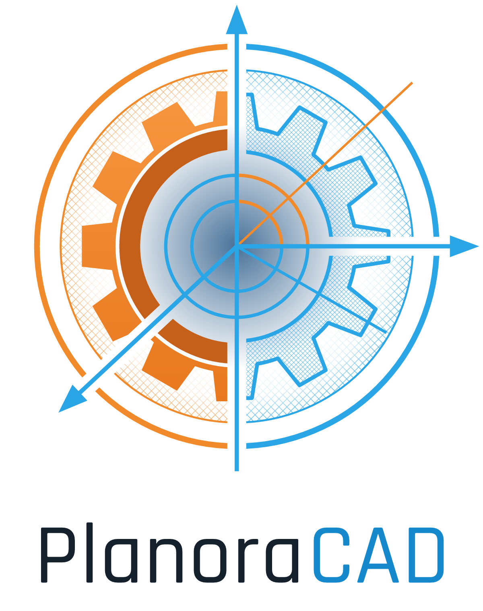
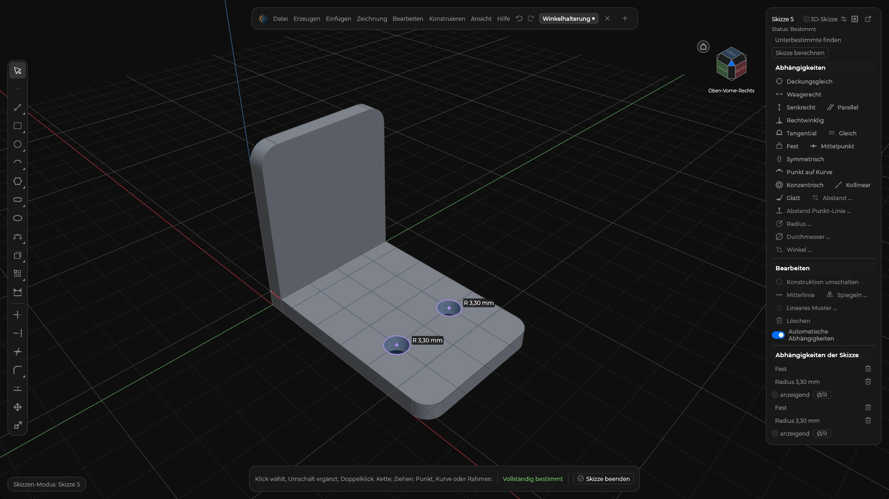
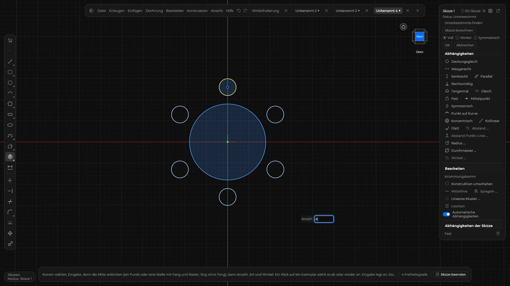
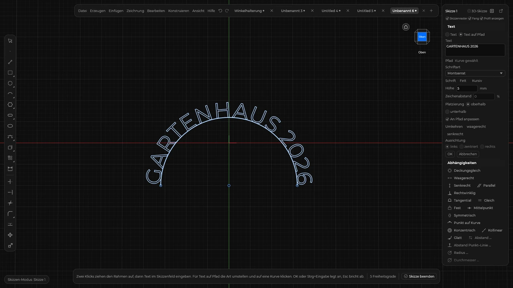
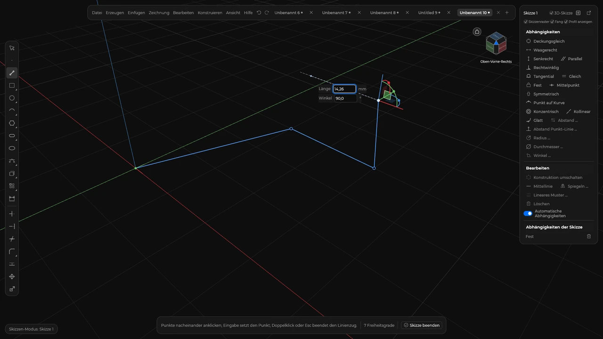
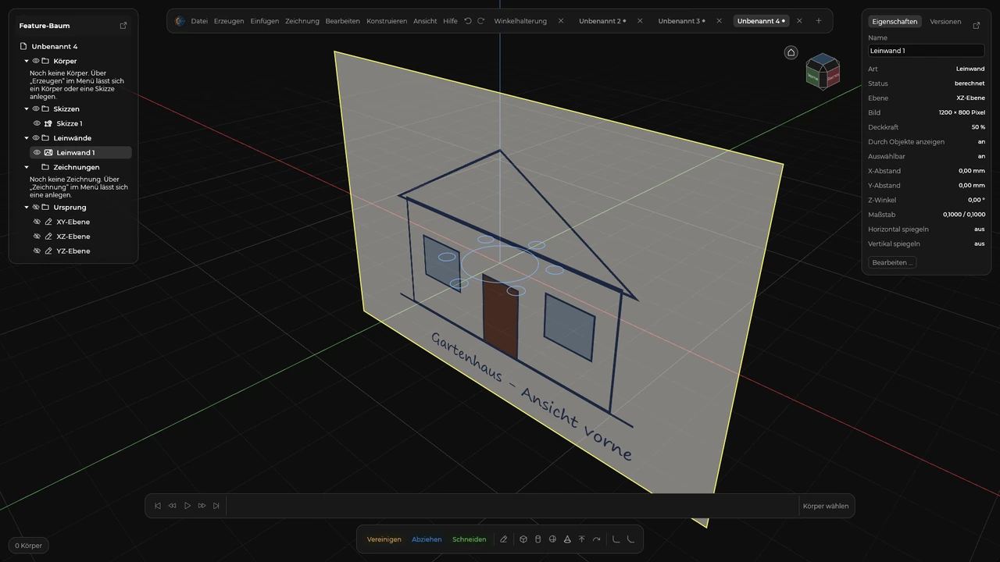
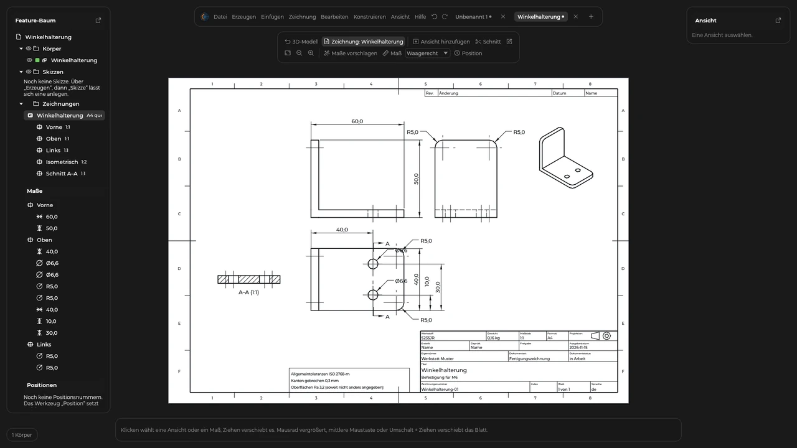
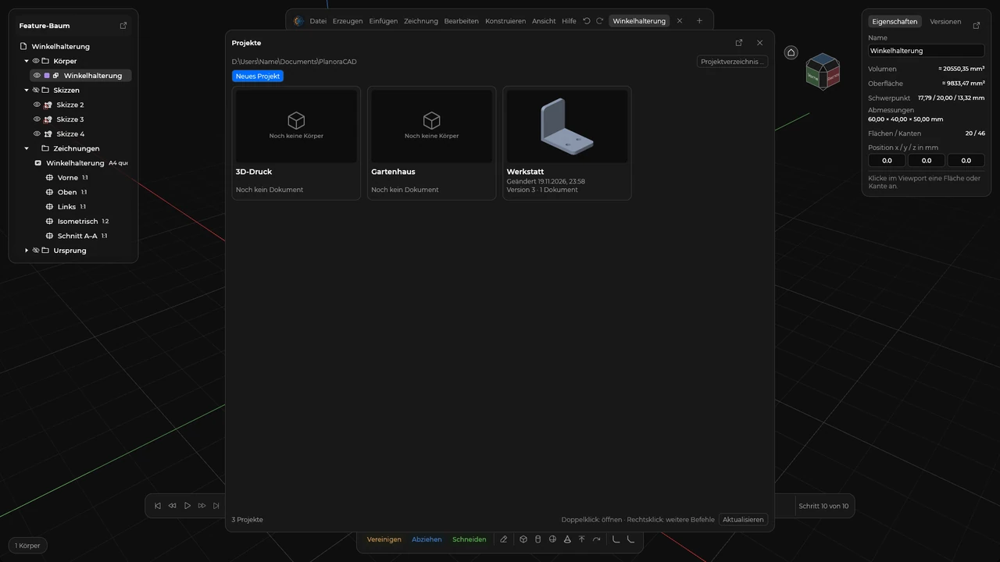

<p align="center">
  <picture>
    <source media="(prefers-color-scheme: dark)" srcset="assets/logo/planoracad-logo-fuer-dunkel.png">
    
  </picture>
</p>

<p align="center">
  <b>Kostenloses 3D-CAD für Windows und Ubuntu: Skizzen zeichnen, Körper bauen, technische Zeichnungen erstellen.</b>
</p>

<p align="center">
  <a href="https://github.com/KaelanTesseract/PlanoraCAD/releases"></a>
  <a href="LICENSE"></a>
  
  
  
</p>

<p align="center">
  <b>Deutsch</b> · <a href="README.en.md">English</a>
  <br>
  <a href="https://github.com/KaelanTesseract/PlanoraCAD/releases">Herunterladen</a> ·
  <a href="https://dennis-guse.de/planoracad/wiki/">Handbuch</a> ·
  <a href="https://dennis-guse.de/projekte/planoracad.html">Projektseite</a> ·
  <a href="CHANGELOG.md">Änderungen</a> ·
  <a href="https://github.com/users/KaelanTesseract/projects/1">Was geplant ist</a>
</p>

<p align="center">
  
</p>

PlanoraCAD ist ein freies Programm, mit dem du Bauteile am Computer in 3D konstruierst: Halterungen, Gehäuse, Ersatzteile oder Teile für den 3D-Druck. Du zeichnest eine Skizze mit Maßen, machst daraus einen Körper und leitest davon eine technische Zeichnung ab. Jeder Schritt wird festgehalten. Änderst du später ein Maß, rechnet das Programm alles neu, was darauf aufbaut.

> [!NOTE]
> **Frühe Testversion.** Die aktuelle Version ist `0.0.2-dev.4` (Entwicklerkanal). Für Windows (64 Bit) gibt es einen fertigen Installer, unter Ubuntu baust du das Programm selbst. Sie ist zum Ausprobieren gedacht, noch nicht für den Alltag. Rechne mit Fehlern und sichere wichtige Projekte zusätzlich. Über jede [Rückmeldung](#fehler-melden-und-wünsche-äußern) freue ich mich.

## Inhalt

- [Was PlanoraCAD kann](#was-planoracad-kann)
- [Bilder](#bilder)
- [Herunterladen und installieren](#herunterladen-und-installieren)
- [Unter Ubuntu](#unter-ubuntu)
- [Updates und Sprache](#updates-und-sprache)
- [Plug-ins](#plug-ins)
- [Fehler melden und Wünsche äußern](#fehler-melden-und-wünsche-äußern)
- [Was noch nicht geht](#was-noch-nicht-geht)
- [Datenschutz](#datenschutz)
- [Für Entwickler](#für-entwickler)

## Was PlanoraCAD kann

**Skizzen**
- Eine Skizze mit einem Klick anlegen: „Skizze erstellen“ zeigt die Grundebenen zur Wahl, du klickst eine Ebene oder eine ebene Fläche an.
- Linien, Rechtecke, Kreise, Bögen, Polygone, Langlöcher, Ellipsen, Splines und Kegelschnitte zeichnen, viele davon in mehreren Arten.
- Maße direkt beim Zeichnen eintippen. Regeln wie „waagerecht“, „parallel“ oder „tangential“ entstehen von selbst.
- Ecken abrunden, Kurven stutzen, dehnen und versetzen, zwei Enden glatt verbinden, Teile verschieben, drehen und spiegeln.
- Kopieren, Ausschneiden und Einfügen, auch in eine andere Skizze.
- Das Programm zeigt, ob eine Skizze ganz bestimmt ist, und findet, was sich noch bewegen lässt.
- Muster in Reihen oder im Kreis, die sich später noch ändern lassen.
- Text im Rahmen oder entlang einer Kurve, mit den Schriften deines Rechners. Höhe und Inhalt können Parameter nutzen.
- Kanten eines Körpers in die Skizze projizieren, DXF- und SVG-Dateien einfügen und ein Foto als Vorlage hinterlegen. Skizzen lassen sich auch als DXF speichern.
- 3D-Skizzen: Kurven frei im Raum zeichnen, zum Beispiel einen Kabelweg.
- Skizzen in Gruppen ordnen und je Skizze wählen, was angezeigt wird. Körper verdecken die Skizze, und „Slice“ schneidet weg, was davor liegt.

**Körper**
- Skizzen herausziehen (extrudieren) oder um eine Achse drehen. Dazu gibt es Quader, Zylinder, Kugel und Kegel.
- Körper vereinigen, voneinander abziehen oder nur die Überschneidung behalten.
- Kanten runden oder abschrägen.
- Parameter mit Formeln: Maße bekommen einen Namen, etwa „Breite = 40“, und andere Maße rechnen damit.
- Hilfsebenen für Skizzen an jeder Stelle des Bauteils.

**Zeichnungen**
- Ansichten von vorne, oben, von der Seite und schräg, dazu Schnitte.
- Maße, Mittellinien, Schriftfeld, Stückliste und Positionsnummern.
- Ausgabe als PDF, SVG oder DXF.

**Austausch mit anderen Programmen**
- STEP lesen und schreiben, das übliche Format zwischen CAD-Programmen.
- Für den 3D-Druck STL und 3MF schreiben, dazu OBJ und glTF. STL und OBJ lesen.

**Arbeiten und Ordnung halten**
- Projekte mit Versionen: Jedes Speichern legt eine neue Version an. Du kannst zu einer alten zurückgehen oder davon abzweigen.
- Eine Verlaufsleiste zeigt alle Schritte eines Bauteils. Du kannst zu jedem Schritt zurückspringen.
- Rückgängig und Wiederholen für jede Änderung.
- Tastenkürzel wie in gängigen CAD-Programmen, alle in den Einstellungen änderbar.
- Hell oder dunkel, Millimeter oder Zoll, Deutsch oder Englisch.
- Felder und Spalten in eigene Fenster lösen, zum Beispiel auf einen zweiten Bildschirm.

Alles mit Einzelheiten steht im [Handbuch](https://dennis-guse.de/planoracad/wiki/) und unter [Funktionen im Detail](docs/funktionen.md).

**Warum PlanoraCAD?**
- **Kostenlos und offen:** Jeder darf den Quelltext ansehen, ändern und weitergeben (GPL-3.0).
- **Deine Dateien bleiben bei dir:** kein Konto, keine Cloud. Projekte sind normale Ordner auf deinem Rechner.
- **Nichts geht verloren:** Alte Versionen bleiben erhalten. Alle zwei Minuten sichert das Programm zusätzlich, und nach einem Absturz bietet es diesen Stand an.
- **Maße bleiben änderbar:** Du passt ein Bauteil an, statt es neu zu zeichnen.

## Bilder

<table>
  <tr>
    <td width="50%"><br><sub>Kreisförmige Anordnung in einer Skizze</sub></td>
    <td width="50%"><br><sub>Text entlang einer Kurve</sub></td>
  </tr>
  <tr>
    <td><br><sub>3D-Skizze mit Kurven im Raum</sub></td>
    <td><br><sub>Bild als Vorlage zum Nachzeichnen</sub></td>
  </tr>
  <tr>
    <td><br><sub>Technische Zeichnung mit Schnitt und Schriftfeld</sub></td>
    <td><br><sub>Projekte mit Vorschau und Versionen</sub></td>
  </tr>
</table>

Weitere Bilder und Anleitungen Schritt für Schritt findest du im [Handbuch](https://dennis-guse.de/planoracad/wiki/).

## Herunterladen und installieren

**Was du brauchst:** Windows 10 oder 11 (64 Bit) oder Ubuntu, eine Grafikkarte mit aktuellem Treiber und einen Bildschirm mit mindestens 1920 × 1080 Pixeln. Die Schritte hier gelten für Windows. Für Ubuntu siehe [Unter Ubuntu](#unter-ubuntu).

1. Öffne die Seite mit den [Veröffentlichungen](https://github.com/KaelanTesseract/PlanoraCAD/releases).
2. Klick bei der neuesten Version unter „Assets“ auf `planoracad-setup-x64.exe`.
3. Starte die Datei mit einem Doppelklick.
4. Windows zeigt wahrscheinlich „Der Computer wurde durch Windows geschützt“. Klick auf „Weitere Informationen“ und dann auf „Trotzdem ausführen“. Die Warnung kommt, weil die Datei nicht digital signiert ist. Lade das Programm deshalb nur von der Seite der Veröffentlichungen.
5. Der Installer führt dich durch fünf Schritte: „Willkommen“, „Lizenz“, „Ordner“, „Installieren“ und „Fertig“.
   - Bei „Lizenz“ setzt du den Haken „Ich stimme der Lizenz zu“.
   - Bei „Ordner“ wählst du „Nur für mich“ (ohne Administratorrechte, passt meistens) oder „Für alle Benutzer“ (Windows fragt dann nach deiner Erlaubnis). Die Verknüpfung auf dem Desktop ist schon angehakt.
6. Klick auf „Installieren“ und am Ende auf „Fertig“. PlanoraCAD steht danach im Startmenü und startet auf Wunsch gleich.

Hält dein Virenprogramm die Datei fest oder startet etwas nicht, schau unter [Häufige Probleme](docs/haeufige-probleme.md). Dein erstes Bauteil baust du mit der Anleitung [Erste Schritte](https://dennis-guse.de/planoracad/wiki/getting-started.html).

<details>
<summary><b>Deinstallieren und wo deine Daten liegen</b></summary>

**Deinstallieren:** In den Windows-Einstellungen unter „Apps“ nach „PlanoraCAD“ suchen und „Deinstallieren“ wählen. Deine Projekte, Einstellungen und Protokolle bleiben dabei erhalten.

**Wo deine Daten liegen:**
- **Projekte:** im Ordner `Dokumente\PlanoraCAD`. Einen anderen Ordner wählst du unter „Datei → Einstellungen …“ mit „Projektverzeichnis ändern …“.
- **Einstellungen, Protokoll, Absturzberichte und Rückmeldungen:** im Ordner `%APPDATA%\PlanoraCAD`. Tipp den Namen oben in die Adresszeile des Explorers.

Brauchst du die Ordner nicht mehr, löschst du sie nach dem Deinstallieren selbst.
</details>

### Unter Ubuntu

PlanoraCAD läuft auch unter Ubuntu. Jede Änderung wird dort automatisch geprüft. Ein fertiges Paket gibt es noch nicht, du baust das Programm einmal selbst aus dem Quelltext. Das dauert beim ersten Mal einige Minuten.

1. Installiere Rust, wie auf [rustup.rs](https://rustup.rs) beschrieben.
2. Installiere die nötigen Bibliotheken:

   ```sh
   sudo apt-get update
   sudo apt-get install -y build-essential pkg-config libclang-dev libgtk-3-dev libxcb-render0-dev libxcb-shape0-dev libxcb-xfixes0-dev libxkbcommon-dev libssl-dev
   ```

3. Lade den Quelltext und starte das Programm:

   ```sh
   git clone https://github.com/KaelanTesseract/PlanoraCAD.git
   cd PlanoraCAD
   cargo run -p planora-app --release
   ```

Unterschiede zu Windows:
- Es gibt keine Updates aus dem Programm. Für eine neue Version holst du den neuen Stand (`git pull`) und startest den Befehl aus Schritt 3 noch einmal.
- Projekte liegen in `~/Documents/PlanoraCAD`, die Einstellungen in `~/.config/planora-cad`.

## Updates und Sprache

**Updates**
- Beim Start schaut das Programm unter Windows höchstens einmal am Tag nach einer neuen Version. Zurzeit gibt es nur Entwicklerversionen (Kanal „Dev“). Unter Ubuntu aktualisierst du von Hand (siehe [Unter Ubuntu](#unter-ubuntu)).
- Gibt es eine, siehst du die Änderungen und wählst „Jetzt aktualisieren“, „Später“ oder „Diese Version überspringen“.
- Bei „Jetzt aktualisieren“ lädt das Programm den neuen Installer, prüft ihn, fragt nach ungespeicherter Arbeit und aktualisiert sich dann selbst. Danach startet die neue Version von allein.
- Klappt etwas nicht, läuft die bisherige Version weiter.
- Abschalten oder von Hand suchen: „Datei → Einstellungen …“, Abschnitt „Updates“. Alle Änderungen stehen in [CHANGELOG.md](CHANGELOG.md).

**Sprache**
- PlanoraCAD gibt es auf Deutsch und Englisch. Beim ersten Start nimmt es die Sprache von Windows, sonst Englisch.
- Umstellen: „Datei → Einstellungen …“, Abschnitt „Darstellung“.
- Du möchtest eine weitere Sprache beisteuern? Die Anleitung (auf Englisch) steht in [docs/uebersetzen.md](docs/uebersetzen.md).

## Plug-ins

PlanoraCAD lässt sich mit Plug-ins erweitern (Windows und Ubuntu). Ein Plug-in ist ein kleines WebAssembly-Programm, das in einer Sandbox läuft und nur darf, was du erlaubst. Du verwaltest Plug-ins im Fenster **Datei → Zusatzmodule → Verwalten …** und installierst sie dort aus dem **Katalog** (Reiter „Katalog“, kuratierte Liste), aus einer Datei (`.pcplugin`) oder über den GitHub-Link des Entwicklers; die Befehle stehen unter **Datei → Zusatzmodule**. Plug-ins müssen unter einer GPL-3.0-verträglichen Lizenz stehen. Mehr dazu: [Plug-ins benutzen](docs/plug-ins.md) und [Plug-ins entwickeln](docs/plugins/entwickler.md). Die Schnittstelle ist Version 0.x und darf noch brechen. Wer unter Ubuntu selbst baut, braucht dafür zusätzlich `libssl-dev` und `pkg-config`.

## Fehler melden und Wünsche äußern

Du hast einen Fehler gefunden, dir fehlt etwas oder du hast eine Frage? Sag es bitte, zwei Sätze reichen.

1. Wähl im Programm „Hilfe → Rückmeldung …“ (oder Strg+Umschalt+R).
2. Wähl Fehler, Wunsch oder Frage und schreib kurz, was passiert ist. Mit Häkchen entscheidest du, welche Angaben mitgehen.
3. Mit GitHub-Konto klickst du auf „Im Browser öffnen“. Ohne Konto klickst du auf „Ohne GitHub-Konto senden“, dann öffnet sich ein Formular auf dennis-guse.de.
4. Prüf die Angaben im Browser und schick das Formular ab.

Du kannst auch direkt auf GitHub eine [neue Meldung](https://github.com/KaelanTesseract/PlanoraCAD/issues/new/choose) anlegen. Geht beides nicht, schreib eine Mail an info@dennis-guse.de.

- Alle Wege Schritt für Schritt: [So meldest du etwas](docs/so-meldest-du-etwas.md)
- Lösungen für bekannte Fälle: [Häufige Probleme](docs/haeufige-probleme.md)
- Geplante Wünsche und laufende Arbeit: [Was geplant ist](https://github.com/users/KaelanTesseract/projects/1)

Meldungen auf GitHub sind öffentlich. Schreib deshalb nichts Privates hinein.

## Was noch nicht geht

- Einen fertigen Installer gibt es nur für Windows (64 Bit). Unter Ubuntu baust du das Programm selbst, und es gibt dort keine Updates aus dem Programm.
- Keine Baugruppen. Aus STEP-Baugruppen wird jeder Körper einzeln übernommen.
- Kein Loft und kein Sweep. Muster und Spiegeln gibt es nur in der Skizze, nicht am Körper.
- Drehen geht nur um volle 360 Grad.
- Rundungen, Fasen und das Kombinieren von Körpern lehnt das Programm in manchen Fällen ab. Es liefert lieber kein Ergebnis als ein falsches.
- Aufwendige Rechnungen, vor allem mit Freiformflächen, können einige Sekunden dauern. So lange reagiert das Fenster nicht.
- Farben und Materialien gehen beim Austausch mit anderen Programmen nicht mit.
- Zweige lassen sich nicht wieder zusammenführen.
- Neue Versionen speichern teils in einem neueren Dateiformat. Ältere Versionen öffnen solche Dateien dann nicht.

Die Grenzen jeder Funktion stehen unter [Funktionen im Detail](docs/funktionen.md).

## Datenschutz

- **Updates:** Das Programm fragt höchstens einmal am Tag bei GitHub (`api.github.com`) nach neuen Versionen, solange die Suche eingeschaltet ist. Zum Herunterladen verbindet es sich mit GitHub. Es schickt dabei keine Projekte, keine Namen und keine Kennung deines Rechners. GitHub sieht wie bei jeder Verbindung deine Internetadresse sowie Name und Version des Programms. Schaltest du die Suche ab, verbindet sich das Programm nie von selbst.
- **Rückmeldungen:** Das Programm schickt nichts von allein. Was mitgehen soll, siehst du vorher und kannst es abwählen. Benutzername, Projektpfade und Mailadressen entfernt das Programm vorher. Die Angaben stehen in der Adresse des Formulars und gehen deshalb schon beim Öffnen im Browser an GitHub oder an dennis-guse.de (sie können dort im Protokoll des Servers stehen). Gespeichert und gemeldet wird erst, wenn du im Formular auf „Absenden“ klickst.
- **Absturzberichte:** Stürzt das Programm ab, schreibt es einen Bericht auf deinen Rechner, ohne deinen Benutzernamen. Beim nächsten Start fragt es, ob du ihn schicken willst. Ohne dein Zutun verlässt er den Rechner nicht. Alte Berichte löscht das Programm nach 30 Tagen.
- **Protokoll:** Die Protokolldatei bleibt auf deinem Rechner. Projektinhalte stehen nicht darin.

Verantwortlich: Dennis Guse, Fischbeker Str. 2a, 23869 Elmenhorst. Kontakt: info@dennis-guse.de.

## Für Entwickler

PlanoraCAD ist in Rust geschrieben (Edition 2024, ab Rust 1.88), mit eigenem Geometrie-Kern. Die Oberfläche läuft mit egui/eframe und wgpu.

### Bauen und prüfen

```sh
cargo run -p planora-app --release
```

```sh
cargo fmt --all --check   # unter Windows je Crate: cargo fmt -p <crate> --check
cargo clippy --workspace --all-targets -- -D warnings
cargo test --workspace
cargo deny check
```

Unter Ubuntu braucht es zusätzlich die Bibliotheken aus [Unter Ubuntu](#unter-ubuntu) (dieselben wie in `.github/workflows/ci.yml`). Die CI prüft jede Änderung unter Windows und Ubuntu.

Den Installer baust du nach `cargo build --release -p planora-app` mit `tools\build-installer.ps1`. Er braucht Inno Setup 6.7 oder neuer für den Installationsteil und bettet ihn in die Oberfläche `planora-setup` ein. Das Ergebnis `planoracad-setup-x64.exe` mit Prüfsumme landet im Ordner `dist`.

### Aufbau

Der Workspace besteht aus 16 Crates unter `crates/`:

| Crate | Aufgabe |
|---|---|
| `planora-math` | Vektoren, Koordinatensysteme, Toleranzen, NURBS |
| `planora-kernel` | Geometrie-Kern (B-Rep): Körper, Boolesche Operationen, Rundungen |
| `planora-mesh` | Körper in Dreiecksnetze zerlegen, Volumen und Schwerpunkt |
| `planora-exchange` | Netze als STL, 3MF, OBJ und glTF; DXF, SVG und Bilder einlesen |
| `planora-step` | STEP lesen und schreiben |
| `planora-sketch` | Skizzen, Abhängigkeiten und Löser |
| `planora-text` | Schriften lesen und Text in Kurven setzen |
| `planora-drawing` | Technische Zeichnungen: Ansichten, Blatt, Maße, Ausgabe |
| `planora-feature` | Feature-Baum, stabile Verweise, Neuberechnung |
| `planora-project` | Projekte, Versionen, Dateiformat, Einstellungen |
| `planora-render` | Kamera, Auswahl in der Ansicht, Darstellung mit wgpu |
| `planora-update` | Neue Versionen finden, laden und prüfen |
| `planora-i18n` | Sprachdateien (Fluent) und Zahlenformat |
| `planora-style` | Farben und Schriften für Programm und Installer |
| `planora-setup` | Installer-Oberfläche, steuert den Inno-Setup-Teil |
| `planora-app` | Das Programm: Fenster, Werkzeuge, Dialoge |

### Release und Absturzberichte

- Eine neue Version entsteht mit `tools\release.ps1`, einem Abschnitt in `CHANGELOG.md`, einem grünen Lauf von `ci.yml` und einem Tag. Der Tag startet `.github/workflows/release.yml`. Das baut die Windows-Version samt Installer und legt das Release an (Installer `planoracad-setup-x64.exe`, Prüfsumme, `THIRD-PARTY-LICENSES.txt` und die Symboldatei `.pdb`).
- Absturzberichte von Testern löst `tools\symbolize.ps1` mit der `.pdb` des Releases auf.
- Alle Schritte: [Updates und Versionen](docs/funktionen.md#updates-und-versionen). Rückmeldungen und Protokoll: [Rückmeldung, Absturzberichte und Protokoll](docs/funktionen.md#rückmeldung-absturzberichte-und-protokoll).
- Die Projekttafel einrichten: [Projekttafel einrichten](docs/projekttafel-einrichten.md).
- Offene Punkte mit Messwerten: [docs/superpowers/offene-punkte.md](docs/superpowers/offene-punkte.md).

### Drittanbieter

- Schrift: Montserrat, OFL 1.1; Symbolschrift Phosphor, MIT; Ersatzschrift Roboto 2.138, Apache-2.0 (siehe `crates/planora-app/assets/fonts/`).
- PDF-Ausgabe: Die Breiten der Helvetica-Buchstaben stammen aus der Adobe-Datei „Helvetica.afm“ der „Core 14 AFM Files“ (AFM 4.1, Version 002.000). Copyright (c) 1985, 1987, 1989, 1990, 1997 Adobe Systems Incorporated. All Rights Reserved. Helvetica is a trademark of Linotype-Hell AG and/or its subsidiaries. Bedingungen der Sammlung (Datei „MustRead.html“): Die Dateien dürfen für jeden Zweck und ohne Gebühr, mit oder ohne Änderung, genutzt, kopiert und weitergegeben werden, wenn alle Urheberrechtsvermerke erhalten bleiben, die AFM-Dateien nicht ohne diesen Hinweis weitergegeben werden, Änderungen deutlich vermerkt werden und der Hinweis selbst nicht verändert wird; Adobe ist nicht zur Unterstützung verpflichtet. Im Quelltext (`crates/planora-drawing/src/pdf_font.rs`) steht nur die Breitentabelle, neu nach dem westeuropäischen Zeichensatz (WinAnsi) angeordnet (eine vermerkte Änderung); die AFM-Datei selbst ist nicht enthalten, und die Schrift wird nicht in die PDF-Dateien eingebettet.

### Lizenz

PlanoraCAD steht unter der GPL-3.0-only, siehe [LICENSE](LICENSE). Die Lizenzen aller Bibliotheken liegen jedem Release als `THIRD-PARTY-LICENSES.txt` bei.
